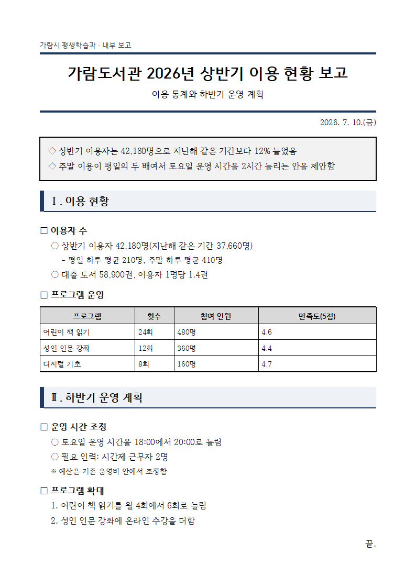
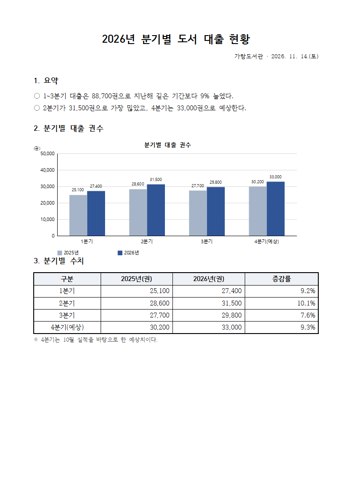
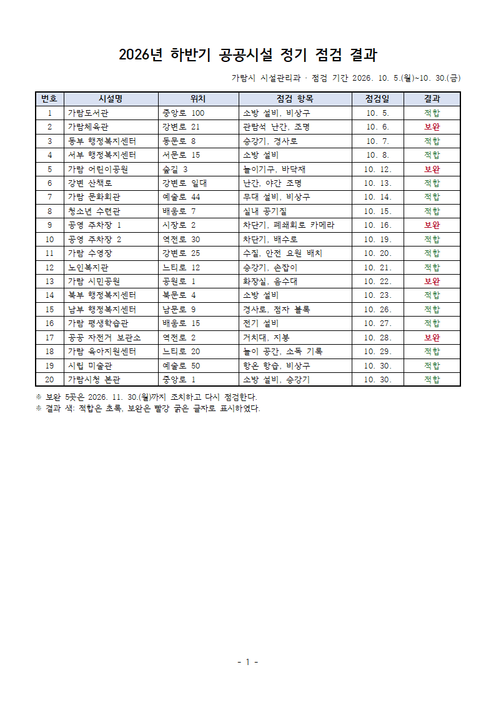

<div align="center">


<h1>hwpx-docs</h1>

<p>한컴오피스 한글에서 여는 HWPX와 HWP 문서를 만들고 읽고 고치고 검사하는 Claude Code 플러그인</p>

<p>
<a href="#한눈에-보기">한눈에 보기</a> ·
<a href="#설치">설치</a> ·
<a href="#추가-플러그인-개인정보-보호-hwpx-docs-privacy">개인정보 보호</a> ·
<a href="#사용-예-프로젝트-계획-문서-만들기">사용 예</a> ·
<a href="docs/">문서</a>
</p>

<p>한국어 · <a href="#english">English</a></p>

<p>
<a href="LICENSE"></a>
<a href=".claude-plugin/plugin.json"></a>
<a href="https://github.com/BlackBuddle/hwpx-docs/stargazers"></a>
<a href="#요구-사항"></a>
<a href="#설치"></a>
<a href="https://www.threads.com/@kimkyuho_98"></a>
</p>

</div>

HWPX(공개 국가표준 OWPML, KS X 6101)와 HWP(HWP 5.0, 한글의 바이너리 형식)를 같은 명령으로 만들고 읽고 고칩니다. 문서를 만들고 읽는 데는 한글 프로그램 없이 Python 표준 라이브러리만 씁니다(버전 0.4.1).

> 한글, 한컴오피스는 (주)한글과컴퓨터의 상표 또는 등록 상표입니다. 이 프로젝트는 (주)한글과컴퓨터와 관계가 없습니다.

## 한눈에 보기

Claude Code에 설치하고 말로 시키면 이런 일을 합니다.

- **문서 만들기**: JSON 스펙, Markdown, HTML에서 .hwpx와 .hwp로. 표, 도형, 그림, 차트, 수식, 각주, 머리말·꼬리말, 공문 형식 지원
- **고치기**: 받은 .hwpx와 .hwp를 읽어 글자만 바꾸거나 문단·행·칸을 늘려 다시 만들기
- **양식 채우기**: 칸 이름이나 칸 번호로 값 넣기, 체크 상자 표시, 고친 뒤 양식이 그대로인지 전후 비교
- **이미지로 받은 양식 다시 만들기**: 선과 격자를 mm 단위로 재서 같은 모양의 한글 양식으로
- **미리보기**: 한글 프로그램 없이 쪽 그림 그리기
- **쪽 맞춤**: 제목이 쪽 끝에 홀로 남거나 표가 어색하게 끊기는 곳을 찾아 고치기(`hd pagefit`)
- **.hwp 지원**: 한글 없이 .hwp(HWP 5.0) 읽기, 고치기, .hwpx와 서로 바꾸기, 스펙에서 새로 만들기
- **추가 플러그인 둘**: 관공서 양식 규칙 묶음(`hwpx-docs-forms`), 문서 속 개인정보(규칙으로 찾은 값)를 가명 꼬리표로 바꿔 모델에게 보여 주는 개인정보 보호 층(`hwpx-docs-privacy`). 따로 설치

## 0.4.0의 새 기능

- **.hwp를 한글 없이 읽고 씁니다.** 받은 .hwp를 .hwpx와 같은 명령으로 읽고 고치고 `hd hwp tohwpx`와 `hd hwp fromhwpx`로 .hwpx와 서로 바꾸고 스펙에서 .hwp를 새로 만듭니다(`hd hwp build`). 법령 별지 서식 153개를 한글 2024와 견준 숫자와 한글과 다른 점은 [.hwp 지원](#hwp-지원-한글-없이) 절에 그대로 적었습니다.
- **표는 글자처럼 취급이 기본입니다.** `inline`을 적지 않은 표는 글자처럼 취급하는 표(`treatAsChar`)로 쓰고 그림과 도형과 같은 기본값입니다. 위치를 정한 표, 머리 행을 반복하는 표, 쪽 높이에 가까운 표는 한글이 쪽 사이에서 나눌 수 있게 자동으로 흐르는 표가 됩니다. `"inline": false`와 `"inline": true`로 직접 정할 수 있습니다(규칙 TB11).
- **양식 추가 플러그인 `hwpx-docs-forms`.** 법령 별지 서식 153개에서 잰 규칙(쪽 크기, 여백, 글꼴, 이름 칸 음영, 선 굵기, 접수 칸·서명란 같은 부품)으로 새 양식을 만듭니다.
- **개인정보 보호 추가 플러그인 `hwpx-docs-privacy`.** 문서 속 주민등록번호, 전화번호, 주소, 계좌, 이름이 모델에게 가면 안 되는 상황을 위한 층입니다. 모델은 `⟪성명1⟫` 같은 꼬리표만 보고 진짜 값은 이 PC의 금고에만 있다가 문서를 쓸 때 돌아옵니다. 하는 일과 한계는 [아래 절](#추가-플러그인-개인정보-보호-hwpx-docs-privacy)에 자세히 적었습니다.
- **남이 준 파일을 더 조심스럽게 엽니다.** 압축을 푼 크기에 상한을 두고 구조가 망가진 복합 파일은 읽다 멈추지 않고 거부합니다. 한글로 여는 일은 스크립트를 비운 사본으로 하고 `--backend auto`는 미리보기를 쓰며 한글은 `--backend hangul`을 줄 때만 씁니다.
- **고친 곳.** .hwp의 변경 추적, 연결 그림, 쪽 연출 소리, 열 정의 문단, 점선·파선 번호, 빈 표 행의 높이를 한글이 저장한 모양에 맞췄습니다.

## 기능 자세히

- JSON 스펙 하나로 문서를 만듭니다(출력 이름이 `.hwpx`면 HWPX, `.hwp`면 HWP). 글자·문단 모양, 탭, 사용자 스타일, 셀 병합과 셀별 선·채움이 있는 표, 도형, 글상자, 그림, 수식, 한글 차트 개체, 쪽 설정, 머리말·꼬리말, 쪽 번호, 각주·미주, 세로쓰기, 상호 참조, 차례, 누름틀, 양식 개체, 변경 추적을 씁니다.
- 기존 HWPX나 HWP를 스펙(JSON)으로 읽고 고친 뒤 다시 만듭니다. 문단·행·칸을 늘리는 일도 이 길로 합니다.
- 받은 양식은 글자만 바꿔 채웁니다. 칸 이름(성명, 연락처 등)이나 칸 번호로 값을 넣고 체크 상자를 표시하고 낱말을 바꿉니다. 바꾼 뒤에는 구조가 같은지, 줄이 늘어 쪽이 밀리는지, 옛 문구나 ○○ 같은 자리표시가 남았는지 검사합니다.
- HWPX나 HWP를 텍스트나 Markdown으로 꺼냅니다. 표는 Markdown 표로, 각주는 `[^n]`으로 바꿉니다.
- Markdown을 개조식 보고서로 바꿉니다(프리셋). HTML은 CSS를 브라우저처럼 계산해 같은 모양의 HWPX로 바꿉니다.
- 목록 항목은 글머리(○, -, ·, 1., 가.) 뒤에 탭 하나를 넣어 둘째 줄부터 첫 줄의 글자 밑에서 시작합니다. 한 목록의 글자 열은 하나이고 보고서 프리셋의 하위 글머리는 위 단계의 글자 열에서 시작합니다. 공문 항목(l1~l8)은 편람대로 단계마다 2타씩 들어가며 붙임 줄도 같은 방식입니다(스펙 키 `hang`). HTML은 `<ol start>`와 `<li value>`를 읽습니다.
- 표 칸의 글은 위아래 가운데에 둡니다. 여러 행에 걸친 칸은 걸친 높이의 가운데에 오고 CSS `height`와 `vertical-align`을 따릅니다. 칸 글은 기본이 양쪽 정렬이고 한 줄짜리 칸은 왼쪽에 남습니다.
- 이미지로 받은 양식을 다시 만드는 절차를 담았습니다. 선과 격자를 mm 단위로 재고 확인 목록을 쓰고 렌더링한 쪽을 겹쳐 비교합니다.
- 한글 없이 쪽 그림을 그립니다(자체 렌더러). 표, 도형, 그림, 차트, 수식, 각주, 세로쓰기, 다단, 어울림 배치, 한글의 쪽 나눔 규칙을 따릅니다.
- 쪽 모양새를 점검하고 고칩니다(`hd pagefit`). 기본은 제목이 쪽 끝에 홀로 남거나 한 줄만 넘어가는 것 같은 최소한만 고칩니다. "읽기 좋게"라고 요청하면 `readable` 프로필로 읽다가 앞쪽을 다시 넘겨야 하는 곳을 없애고 쪽은 꽉 차게 맞춥니다.
- 문서 암호와 배포용 문서는 한글로 넣습니다. 주민등록번호·전화번호·이메일·카드 번호 가리기는 한글 없이 합니다(`hd secure`).
- HWP와 HWPX를 서로 바꾸고 PDF로 저장합니다(`hd convert`, 한글 필요). 한글 없이는 `hd hwp tohwpx`, `hd hwp fromhwpx`로 바꿉니다.
- 받은 .hwp(HWP 5.0)도 .hwpx와 같은 명령으로 한글 없이 다룹니다. 글자만 바로 고쳐 나머지 바이트는 그대로 둡니다(`hd edit`). 칸 이름·칸 번호·누름틀로 값을 넣고 고친 뒤 양식이 그대로인지 전후 파일을 비교하며(`hd guard`), .hwp를 쪽 그림으로 그려 전후 쪽을 나란히 봅니다(`hd preview`, `hd hwp compare`). 쪽 맞춤, 가독성 점검, 개인 정보 가리기, 새 문서 만들기는 .hwp → HWPX → 명령 → .hwp 길로 같은 명령이 처리합니다([HWPX와 HWP 대조표](docs/hwp-parity.md)).
- 공문은 시작 스펙과 공문 문장 규칙(gongmun-style 스킬)으로 씁니다.
- 가독성을 점검합니다(RD01~RD14). 단어 중간 줄바꿈, 양쪽 정렬로 벌어진 빈칸, 선에 붙은 셀 글자, 끝 줄에 단어 몇 개만 남는 문단 같은 문제를 찾습니다. 끝 줄이 글줄 폭의 30 % 미만이거나 2어절 이하(60 % 미만)인 문단(RD14)은 문단 자간을 1 %씩 바꿔 고칩니다. 먼저 -8 %까지 줄여 한 줄을 없애고 안 되면 +4 %까지 늘려 같은 줄 수로 끝 줄을 채웁니다. 새 문서(Markdown)만 고치고 이미 있는 문서와 HTML은 알려만 줍니다.

양식마다 따로 짠 코드는 없습니다. 모든 문서는 같은 기본 요소(쪽, 문단, 런, 표, 도형, 그림)로 만들고 기본 요소마다 쓰는 XML은 한글 2024가 저장한 파일에서 확인했습니다.

## 예제

| 공문 안내문 | 개조식 보고서 (Markdown) | 회의록 |
|---|---|---|
|  |  |  |
| [notice.json](examples/gongmun-notice/notice.json) | [report.md](examples/report-markdown/report.md) | [minutes.json](examples/meeting-minutes/minutes.json) |

| 신청서 (체크 상자) | 차트가 있는 보고 | 표 중심 목록 |
|---|---|---|
|  |  |  |
| [form.json](examples/application-form/form.json) | [report.json](examples/chart-report/report.json) | [list.json](examples/facility-checklist/list.json) |

예제의 기관, 사람, 연락처는 모두 가상입니다. 그림은 한글 2024가 렌더링한 1쪽이며 폴더마다 원본, `.hwpx`, 1쪽 PNG가 있습니다.

## 설치

Claude Code에서 다음을 입력합니다.

```
/plugin marketplace add BlackBuddle/hwpx-docs
/plugin install hwpx-docs@blackbuddle
```

터미널에서는 `claude plugin marketplace add BlackBuddle/hwpx-docs`, `claude plugin install hwpx-docs@blackbuddle`입니다. 설치하면 스킬 11개가 생깁니다.

추가 플러그인은 필요한 사람만 같은 저장소에서 따로 설치합니다. 본체를 먼저 설치해야 합니다. 추가 플러그인을 설치하지 않으면 본체는 그대로 가볍습니다.

```
/plugin install hwpx-docs-forms@blackbuddle      # 관공서 양식 규칙 묶음
/plugin install hwpx-docs-privacy@blackbuddle    # 개인정보 보호 층
```

터미널에서는 `claude plugin install hwpx-docs-forms@blackbuddle`, `claude plugin install hwpx-docs-privacy@blackbuddle`입니다. 추가 플러그인마다 스킬이 하나씩 있습니다(`hwpx-forms`, `hwpx-privacy`).

| 스킬 | 하는 일 |
|---|---|
| hwpx-core | 스펙으로 만들기, 읽기, 만들고 확인하는 순서, 다른 스킬 안내 |
| hwpx-text | 글자·문단, 링크·각주·필드·수식, Markdown·HTML 변환, 프리셋, 가독성 점검 |
| hwpx-table | 표: 열 너비, 행 높이, 병합, 셀별 선·채움, 머리 행 반복, 캡션, 계산식 |
| hwpx-objects | 도형, 글상자, 그림, 차트 |
| hwpx-page | 용지, 여백, 가로 방향, 다단, 머리말·꼬리말, 쪽 번호 |
| hwpx-from-image | 이미지 양식을 그대로 다시 만드는 절차 |
| hwpx-edit | 받은 양식 채우기, 문구 바꾸기와 검사, 텍스트·Markdown 추출 |
| hwpx-gongmun | 공문(기안문·시행문), 개조식 보고서 |
| hwpx-security | 한글의 파일 접근 허용 창, 공식 보안 모듈, 문서 암호, 배포용 문서, 개인 정보 가리기 |
| hwpx-readability | "읽기 좋게", 쪽 넘김 줄이기, 표 안 끊기게, 쪽 꽉 차게 (요청할 때만) |
| gongmun-style | 공문 문장 규칙(어투, 단어, 항목 기호, 날짜·금액 표기)과 검사기 |

## 요구 사항

문서를 만들고 읽는 일에는 한글이 필요 없습니다. 한글이 그린 쪽으로 확인하거나, 변환하거나, 암호를 넣을 때만 한글 2024를 씁니다.

| 작업 | 한글 | 필요한 것 |
|---|---|---|
| 만들기·읽기·채우기·추출 (`build`, `read`, `md`, `html`, `slots`, `edit`, `guard`, `text`, `form`), 파일은 .hwpx와 .hwp 모두 | 필요 없음 | Python 3.10 이상(3.14에서 시험), 운영체제 무관 |
| 점검과 고치기 (`readability`, `check`, `pagefit`, `gongmun-check`), 개인 정보 가리기 (`secure --mask-private`), .hwpx와 .hwp 모두 | 필요 없음 | Python 3.10 이상 |
| 한글 없이 쪽 그림 (`preview`, `render hwpx f --backend preview`) | 필요 없음 | 쪽 SVG·HTML은 어디서나 나옵니다. PNG는 Windows의 Microsoft Edge로 만듭니다. 한글과 같은 줄 나눔을 보려면 한글 글꼴(함초롬바탕 등)이 설치돼 있어야 합니다 |
| 실제 글꼴 폭으로 줄 수 계산 | 필요 없음 | Windows(GDI). 다른 운영체제에서는 추정 폭을 씁니다 |
| 한글로 쪽 그림 그리기, 열리는지 확인, 왕복 시험 (`render`, `roundtrip`) | 한글 2024 | Windows, pywin32 |
| HWP↔HWPX 변환, PDF 저장 (`convert`) | 한글 2024 | Windows, pywin32. 한글 없이 바꾸려면 `hd hwp tohwpx`, `hd hwp fromhwpx` |
| 문서 암호, 배포용 문서 (`secure --password-env`, `--distribute`) | 한글 2024 | Windows, pywin32 |
| 한글의 접근 허용 창 없애기 | 한글 2024 | 선택. 한컴 공식 보안 모듈을 사용자가 직접 등록합니다(아래 절) |
| HTML 인쇄 모양과 비교 | 필요 없음 | Windows, Microsoft Edge |

## 빠른 시작

Claude에게 말로 시키면 스킬이 알맞은 명령을 고릅니다. 예: "이 Markdown을 한글 문서로 만들어 줘", "이 신청서 이미지를 그대로 hwpx로 만들어 줘", "가람시 공문으로 교육 안내문을 써 줘", "받은 신청서에 내 정보를 채워 줘", "이 보고서 읽기 좋게 쪽을 맞춰 줘".

명령을 직접 쓸 때는 플러그인 폴더의 `lib/hd.py`를 실행합니다.

```
python lib/hd.py build examples/meeting-minutes/minutes.json minutes.hwpx
python lib/hd.py md examples/report-markdown/report.md report.hwpx
python lib/hd.py html page.html page.hwpx
python lib/hd.py read some.hwpx some.json
python lib/hd.py readability minutes.hwpx
python lib/hd.py slots form.hwpx
python lib/hd.py edit form.hwpx filled.hwpx --values values.json
python lib/hd.py guard form.hwpx filled.hwpx --forbid 옛기관명
python lib/hd.py text some.hwpx --md
python lib/hd.py pagefit check report.hwpx --profile readable
python lib/hd.py pagefit fix report.hwpx report-fit.hwpx --profile readable
python lib/hd.py secure report.hwpx report-masked.hwpx --mask-private
python lib/hd.py preview minutes.hwpx pages/
python lib/hd.py render hwpx minutes.hwpx pages/            # 한글 없는 미리보기. 한글이 그린 쪽은 --backend hangul
python lib/hd.py selftest
```

받은 .hwp는 파일 이름만 바꿔 같은 명령으로 한글 없이 고칩니다. 칸 이름과 번호는 .hwpx와 같고 누름틀이 있는 문단은 누름틀 안을 채웁니다.

```
python lib/hd.py slots form.hwp
python lib/hd.py edit form.hwp filled.hwp --values values.json
python lib/hd.py guard form.hwp filled.hwp --render pages/
python lib/hd.py hwp compare form.hwp filled.hwp pages/
python lib/hd.py preview form.hwp pages/
python lib/hd.py pagefit fix form.hwp form-fit.hwp
python lib/hd.py build examples/meeting-minutes/minutes.json minutes.hwp
```

`.hwp`를 받는 명령은 `hd slots`, `hd edit`, `hd guard`, `hd text`, `hd preview`처럼 .hwpx와 같은 이름으로 씁니다. `edit`은 글자만 바꾸고 파일의 나머지 바이트를 그대로 둡니다. `pagefit`, `readability`, `check`, `form fill`, `secure --mask-private`, 만들기(`build`, `md`, `html`)는 .hwp를 임시 HWPX로 바꿔 처리한 뒤 새 .hwp를 씁니다. 한글 없이 .hwp를 쓰는 길은 양식 개체(체크 상자, 라디오 단추, 목록)까지 쓰며 시험한 파일에 나온 적 없는 개체나 값이 있을 때만 `UNSUPPORTED <요소>`로 멈추고 파일을 쓰지 않습니다.

`guard`는 구조(DocInfo·표·칸·개체가 바이트 단위로 같은지), 줄 수(한글이 저장한 줄 배치와 비교), 남은 글자를 보고 `--render`를 붙이면 전후 쪽을 그려 비교합니다. 한글 없이 그리는 쪽(`--backend preview`)에서는 쪽마다 글자만 바뀌었으면 `TEXT`, 표 선이나 상자가 움직였으면 `FORM`으로 알리고 바뀐 곳을 빨강·파랑 상자로 표시한 `<이름>_compare.html`을 씁니다.

`python lib/hd.py help`는 명령 전체를 보여 줍니다. `values.json`에는 칸 이름이나 `slots`가 보여 준 칸 번호를 씁니다(예: `{"성명": "가람", "t1.r3c2": "000-0000-0000"}`). 없는 칸 이름이 있으면 `UNMATCHED`를 알리고 파일을 쓰지 않습니다.

스펙 형식은 [docs/spec.md](docs/spec.md)에 있습니다. 같은 모양을 여러 번 쓸 때는 `styles`에 이름을 붙이고 문단·셀·런에서 `"class": "이름"`으로 가져다 쓰고 한글의 스타일 목록에 들어가는 스타일은 `named_styles`로 만듭니다. 0.3.0에서 늘어난 스펙 키(바탕쪽 `master_pages`, 세로쓰기 `text_direction`, 첫 글자 장식 `dropcap` 등)는 spec.md의 "More keys of the feature packages" 절에 키마다 값과 예시 한 줄로 정리했습니다.

## 사용 예: 프로젝트 계획 문서 만들기

어느 팀이 다음 단계 계획서를 한글 문서로 내야 하는 상황을 예로 듭니다. 실제로 쓴 과정을 일반화했고 예시 파일(가상 내용)은 [examples/plan-workflow](examples/plan-workflow)에 있습니다.

1. **참고자료 모으기.** 자료를 한 번에 하나씩 건네면 Claude가 번호(REF-1, REF-2 …)를 붙여 기록하고 읽으면서 나온 결정 거리를 미결 결정 목록에 모읍니다. 기록 예시는 [references.md](examples/plan-workflow/references.md)입니다.
   > "1단계 운영 결과 보고야. REF로 기록하고 정해야 할 것이 있으면 목록에 넣어 줘."
2. **결정하고 계획서 쓰기.** 미결 결정을 하나씩 정하면 Claude가 결과와 근거 번호를 적고 결정이 다 끝나면 그 내용으로 공문 형식의 Markdown(또는 HTML) 계획서를 씁니다. 문장은 gongmun-style 규칙으로, 설명하는 글은 ko-writing 규칙으로 다듬습니다. 결과는 [plan.md](examples/plan-workflow/plan.md)입니다.
   > "D-1은 6과목으로 하자. 결정을 반영해서 공문 형식으로 계획서를 써 줘."
3. **HWPX 만들기.** Markdown은 개조식 보고서 프리셋으로, HTML은 CSS를 계산해 HWPX로 바꿉니다.
   > "이 계획서를 한글 문서로 만들어 줘."
   ```
   python lib/hd.py md plan.md plan.hwpx
   ```
4. **쪽 넘김 줄이기.** `readable` 프로필은 제목과 첫 내용, 표와 캡션 같은 읽기 단위를 한 쪽에 묶고 긴 표는 머리 행을 반복합니다. 표를 통째로 넘겨 앞 쪽이 크게 비면 큰 표만 행 사이에서 나눕니다. `check`로 먼저 보고 `fix`로 새 파일을 씁니다.
   > "읽기 좋게 쪽을 맞춰 줘."
   ```
   python lib/hd.py pagefit check plan.hwpx --profile readable
   python lib/hd.py pagefit fix plan.hwpx plan-fit.hwpx --profile readable
   ```
5. **쪽마다 확인하기.** 한글이 있으면 한글로 열어 보고 없으면 자체 렌더러로 쪽 그림을 만들어 봅니다.
   > "쪽마다 그림으로 보여 줘."
   ```
   python lib/hd.py render hwpx plan-fit.hwpx pages/ --backend preview
   ```
6. **다시 고치기.** 내용이 바뀌면 Markdown을 고치고 3~5단계를 다시 돌리면 되고 쪽 모양만 거슬리면 어느 쪽의 무엇인지 말해 주면 됩니다.
   > "2쪽 표가 다음 쪽으로 넘어가지 않게 해 줘."

예시의 [plan.hwpx](examples/plan-workflow/plan.hwpx)는 plan.md에 3~4단계를 그대로 적용한 결과입니다.

## 프리셋과 --fallback

Markdown 변환은 프리셋(JSON 데이터)에서 글꼴, 크기, 간격, 상자 모양을 가져옵니다. 기본 프리셋은 `report-gongmun`(제목 상자, 장 막대, □ ○ - · 항목, 격자 표)입니다.

프리셋에 스타일이 없는 요소(본문 인용문, 그림, 4단계 목록, 각주 등)를 만나면 `UNMAPPED`로 줄 번호와 함께 알리고 멈춥니다. `--fallback`을 붙이면 가까운 프리셋 스타일, 코어 기능, 일반 문단 순서로 대신하고 바꾼 내역을 `FALLBACK` 줄로 남깁니다. 프리셋을 늘리거나 HWPX 샘플에서 새 프리셋을 만드는 방법은 [hwpx-text 스킬의 presets.md](skills/hwpx-text/references/presets.md)에 있습니다.

## 쪽 모양새 맞추기 (pagefit)

`hd pagefit check`는 쪽마다 얼마나 찼는지, 무엇 때문에 쪽이 넘어가는지 보여 주고 `hd pagefit fix`는 스펙을 고쳐 새 파일로 씁니다. 글자 크기, 내용, 순서는 바꾸지 않습니다. 바꾸는 것은 "다음 문단과 함께" 같은 문단 설정, 쪽 나눔, 문단·표 간격뿐입니다.

무엇을 얼마나 고칠지는 개인의 읽기 스타일이라 프로필로 고릅니다.

| 프로필 | 하는 일 |
|---|---|
| `minimal` (기본) | 제목을 다음 문단과 함께 두고 쪽 끝·쪽 처음에 한 줄만 남지 않게 합니다. 거의 빈 쪽 뒤의 강제 쪽 나눔을 풀고 짧은 마지막 쪽을 끌어올리고 남는 공간은 문단 간격으로 채웁니다 |
| `readable` | 위에 더해 "읽기 단위"가 쪽을 넘어 끊기지 않게 합니다. 제목과 첫 내용, 항목과 하위 항목, 표와 캡션·소개 문장·주석, 그림과 캡션, 요약 상자, 붙임 목록, 마지막 문단과 "끝."·결문이 한 단위입니다. 쪽보다 긴 표는 행 사이에서만 나누고 머리 행을 반복하며 앞뒤 조각을 3행 이상으로 맞춥니다. 쪽의 1/3 이상인 표를 통째로 넘기면 앞 쪽이 40 mm 넘게 빌 때는 그 표만 행 사이에서 나눕니다. 통째로 두는 표는 문단과 같은 쪽에 묶어(`hold`) 뒤의 제목과 글이 표 앞으로 올라오지 않게 하고 머리 행이 없는 긴 표는 머리 행처럼 보이는 첫 행을 반복합니다. 각주가 다음 쪽으로 이어지면 그 문단을 다음 쪽에서 시작하고 표를 가리키는 문장이 다른 쪽에 있으면 알립니다 |
| 직접 만든 파일 | `--profile 내것.json`. `"extends": "readable"`로 시작해 바꿀 값만 씁니다. 형식은 [pagefit/rules.md](lib/hwpx_docs/pagefit/rules.md)의 PF22에 있고 `hd pagefit profiles readable`이 전체 값을 보여 줍니다 |

쪽 배치는 자체 렌더러의 줄 높이와 한글에서 잰 쪽 나눔 규칙으로 계산합니다. 실제 계획 문서 7개(각주 11개씩)에 `readable`을 적용해 한글로 열어 보니 쪽 수가 모두 계산과 같았고 제목만 쪽 끝에 남은 곳이 8곳에서 0곳으로, 100 mm 넘게 빈 쪽이 3쪽에서 1쪽으로 줄었습니다. 표가 뒤로 밀려 읽는 순서가 바뀐 곳은 한 문서에서 11곳에서 0곳이 됐습니다. 한글이 설치돼 있으면 고친 파일을 한글로 한 번 열어 확인하는 것이 좋습니다.

## .hwp 지원 (한글 없이)

.hwp(HWP 5.0, 한글의 바이너리 형식)는 .hwpx와 같은 이름의 명령으로 다룹니다. 명령마다 어떻게 되는지는 [HWPX와 HWP 대조표](docs/hwp-parity.md)에 있습니다.

- 글자만 바꾸는 일(`hd edit`)은 원본 파일의 나머지 바이트를 그대로 둡니다.
- 문단·행·칸을 늘리거나 새로 만드는 일은 .hwp → HWPX → 명령 → .hwp 길로 갑니다. 이 길은 `hd hwp tohwpx`(.hwp → HWPX), `hd hwp fromhwpx`(HWPX → .hwp), `hd hwp build`(스펙 → .hwp)가 맡습니다.
- 쓰는 쪽(`fromhwpx`)은 양식 개체(체크 상자, 라디오 단추, 목록), 변경 추적, 연결 그림, 쪽 연출까지 씁니다. 한글 2024가 저장한 모양에 맞춰 레코드 하나하나를 썼습니다.

법령 별지 서식 153개(law.go.kr의 빈 양식)를 한글 2024와 견준 결과입니다. 견주는 기준은 "한글 프로그램이 같은 문서를 직접 저장한 파일"이고 바이트가 같은지는 기준이 아닙니다. 한글이 저장할 때마다 새로 정하는 값(캐럿 위치, 개체 번호)과 한글이 저장하지 않는 값은 견줄 때 뺍니다.

| 확인 | 결과 |
|---|---|
| .hwp → HWPX가 한글이 직접 저장한 HWPX와 같은 양식 | 130/153. 나머지 23개는 글꼴 종류 표시, 쓰지 않는 문단·글자 모양 개수, 줄 배치 정보, 그림 바이트 같은 값이 다릅니다 |
| HWPX → .hwp가 한글이 저장한 .hwp와 레코드 단위로 같은 양식 | 153/153. 원본 값을 지켜서 생긴 차이(음수 탭 위치 2개, HWPX에 담을 자리가 없는 범위 표시 1개)는 이유를 적고 허용으로 셉니다. 허용 없이 엄격하게 세면 150/153입니다 |
| .hwp → HWPX → .hwp 왕복이 한글 수준과 같은 양식 | 129/153 |
| 쓴 HWPX를 한글로 열었을 때 쪽 수가 같고 쪽마다 잉크 차이가 1.0 % 이하 | 153/153 |
| 왕복한 .hwp를 한글로 열기 | 153/153이 열리고 쪽 수가 같습니다 |
| 스펙에서 만든 .hwp(`hd hwp build`) | 쪽 수는 153/153이 같고 쪽 모양이 1.0 % 이내로 같은 것은 60/153입니다 |
| 시험 파일 774개(공개 .hwp 표본) | .hwp → HWPX가 멈춘 파일 4개, HWPX → .hwp가 멈춘 파일 0개. 비밀번호·배포용·HWP 3처럼 읽지 않는 파일 37개는 뺐습니다 |

한글과 같지 않은 점입니다.

- 위 숫자의 나머지 양식은 한글 저장본과 다릅니다. `hd hwp build`는 쪽 수가 같아도 표와 글자 위치가 한글 저장본과 1 % 넘게 다른 양식이 93개입니다.
- 한글은 HWPX를 .hwp로 저장할 때 대체 글꼴 같은 값을 자기 규칙으로 정합니다. 원본 .hwp에 있던 그 값은 HWPX에 자리가 없는 것이 있어서 .hwp → HWPX → .hwp로 돌린 파일은 원본과 바이트가 같지 않습니다. 원본 바이트를 지키는 것은 `hd edit`뿐입니다.
- 변경 추적 문서는 본문을 두 가지 모양으로 저장하는 파일이 있습니다. 한쪽 모양은 HWPX에서 되살릴 수 없어서 한글이 저장한 것과 같게는 쓰지 못합니다.
- 연결 그림은 파일 경로를 적고 .hwp 안의 상대 경로는 출력 위치에 맞춰 다시 계산합니다. 다른 드라이브의 경로 형식은 파일 하나로 확인했습니다.
- 시험한 파일에 나온 적 없는 개체나 값을 만나면 `UNSUPPORTED <요소>`로 멈추고 파일을 쓰지 않습니다.
- 암호·배포용·DRM 문서와 HWP 3(한글 97) 파일은 열지 않습니다.

## 추가 플러그인: 양식 팩 (hwpx-docs-forms)

관공서 양식(법령 별지 서식)을 실제 양식에서 재어 만든 규칙 묶음입니다. 새 양식을 만들 때 그 양식 가족의 쪽 크기와 여백, 글꼴, 이름 칸 음영, 선 굵기와 접수 칸, 신청인 표, 서명란, "○○○ 귀하", 처리 절차 상자를 가져다 씁니다. 규칙은 일반 규칙과 재사용 부품으로 이루어집니다.

- 규칙마다 근거를 `n/N`으로 적습니다(예: `A4 세로 152/153`). 양식의 절반이 따르지 않는 규칙은 기본값에 넣지 않고 선택 값으로 둡니다.
- 쓰겠다고 고른 문서에만 적용합니다.
- 확인: 양식 16개를 내용만 남긴 스펙에서 다시 만들어 한글 쪽 그림을 원본과 견줬더니, 팩을 쓴 결과는 쪽 수가 16/16 같았고 팩 없이 만든 결과는 15/16이 같았습니다. 쪽별 잉크 차이 평균은 팩을 쓴 결과 53.5 %, 팩 없이 만든 결과 88.3 %입니다. 팩 값과 다른 여백을 쓰는 양식은 여전히 크게 어긋납니다.
- 쓰는 법: 본체를 먼저 설치하고 추가 플러그인을 설치한 뒤 "별지 서식 팩으로 신청서를 만들어 줘"처럼 말합니다. 스킬 `hwpx-forms`가 규칙을 보여 주고 스펙에 합쳐 본체 `hd build`로 만듭니다.

## 추가 플러그인: 개인정보 보호 (hwpx-docs-privacy)

한글 문서를 클라우드 모델과 함께 다룰 때 평소 작업에서 개인정보가 모델로 나가지 않게 하는 층입니다(규칙으로 찾은 값에 한합니다. 일부러 하는 우회는 막지 못합니다. 아래 한계 참조). 필요한 사람만 설치합니다. 설치하지 않으면 본체에는 이 층의 코드도 훅도 없습니다. 이 층은 **일상 작업의 실수를 막는 장치**이고 일부러 만든 우회를 막지 못합니다([한계](#개인정보-보호의-한계)).

### 무엇을 하나

- 모델은 `hd`가 보여 주는 글에서 개인정보 대신 **가명 꼬리표**를 봅니다(찾는 규칙에 기반하므로 낯선 배치는 놓칠 수 있습니다). 문서에서 읽은 주민등록번호, 전화번호, 주소, 계좌, 이름 같은 값은 `⟪주민번호1｜1980년대·남⟫`, `⟪성명1⟫`, `⟪전화번호1⟫` 같은 짧은 꼬리표로 바뀌어 나옵니다. 같은 값은 같은 꼬리표를 받으므로 "신청인과 대리인이 같은 사람인지" 같은 맥락은 남습니다.
- 진짜 값은 **이 PC의 금고**(Windows DPAPI)에만 있습니다. 모델에게 가지 않습니다.
- 모델이 꼬리표로 문서를 고치면 **문서를 쓰기 직전에 꼬리표가 진짜 값으로 돌아갑니다.** 꼬리표 뒤 조사도 진짜 낱말에 맞게 고쳐집니다(`⟪성명1⟫은` → `가람은`). 모르는 꼬리표는 오류로 멈춥니다.
- 주민등록번호는 나이대와 성별만 꼬리표에 담깁니다. 정확한 값이 필요한 질문("19세 이상인가?")은 `pv.py calc`가 이 PC에서 계산해 예·아니오로만 답합니다(`age`, `sex`, `same`, `count`).
- 가린 사본이 필요하면 `pv.py mask-copy 원본.hwpx 사본.hwpx`가 문서 정보(작성자, 제목), 변경 추적 작성자, 메모, 숨은 설명, 그림 속 정보(EXIF), OLE 안, 미리보기까지 가린 HWPX를 씁니다. 그림은 같은 종류의 자리 표시 그림으로 바꿉니다.

### 사용자가 보는 모습

모델이 `hd slots 신청서.hwpx`로 읽으면 값 자리에 이런 꼬리표가 보입니다(모양은 줄여 그린 예시입니다).

```
성명        ⟪성명1⟫
주민등록번호  ⟪주민번호1｜1980년대·남⟫
전화번호      ⟪전화번호1⟫
주소        ⟪주소1⟫
```

모델이 꼬리표를 그대로 써서 고치면(예: `hd edit 신청서.hwpx 결과.hwpx --set "성명=⟪성명1⟫"`) 결과 파일에는 진짜 이름이 들어갑니다. 모델이 본 것은 꼬리표뿐입니다.

### 무엇을 가리나

수준은 둘입니다. 설정 파일의 `mode`로 고르고 환경 변수 `HWPX_PRIVACY_MODE=strict`는 수준을 올리기만 합니다.

| 수준 | 가리는 것 |
|---|---|
| `standard` (기본) | 식별번호(주민등록번호, 외국인등록번호, 여권, 운전면허), 이름, 연락처(주소, 우편번호, 전화, 이메일, SNS, IP, MAC, 좌표, 차량번호), 금융(계좌, 카드, 증권계좌, 지갑, 소득·부채, 신용, 사업자번호), 그림과 문서 속 숨은 곳 |
| `strict` | 위에 더해 기타 번호(학번, 사번, 군번, 수험번호, 환자번호, 보험번호, 사건번호, 민원번호, 회원번호, 자격번호), 생년월일·나이·국적·학교·직장, 가족, 민감 낱말 사전(질환, 약, 죄명, 종교, 정당·노조, 장애 유형), 양식에 써 넣은 모든 칸 |

찾는 방법은 네 층입니다. 검산이 되는 모양(주민등록번호 날짜·검증 숫자, 카드 Luhn, 사업자번호 검증)을 찾고 양식의 이름표 옆 값을 찾고 문장 속 이름(성 + 이름 + 직함이나 조사)을 찾고 strict에서는 사전 낱말을 찾습니다. 문서에서 한 번 본 값은 어디에 나와도 가리고(구분 문자가 달라도) 빈 양식 폴더를 `HWPX_PRIVACY_TEMPLATES`에 지정하면 양식에 사람이 적어 넣은 칸은 값의 모양과 관계없이 가립니다. 제품번호, 바코드처럼 주민등록번호와 닮은 번호는 지나가게 하고 공개 빈 양식의 고정 문구와 공개 번호는 오탐을 막으려고 건너뜁니다. 규칙은 데이터 묶음이고(`kr-identifiers`, `kr-person`, `kr-contact`, `kr-finance`, `kr-other-ids`, `kr-sensitive-terms`, `doc-hidden`, `kr-lookalike`, `kr-fixed-text`) 새 나라나 새 종류는 묶음 폴더 하나로 더합니다.

로컬 모델은 쓰지 않습니다. 정부 PC처럼 모델 실행 환경을 설치하기 어려운 곳에서도 모든 기능이 돕니다.

### 막는 것

훅이 모델의 도구 호출을 검사합니다. 확실한 것만 막고 사용자의 평소 작업은 지나가게 합니다.

- **원본 직접 읽기.** `Read`로 한글 문서(이름을 바꾼 사본 포함)나 `hd`가 만든 바이너리 파일, 문서에서 나온 그림, 금고 폴더를 여는 일을 막습니다. 확실한 개인정보 값이 든 파일도 막습니다. `Grep`도 같은 검사를 합니다.
- **명령으로 문서 꺼내기(Bash, PowerShell, Monitor).** `unzip`, `cat`, `strings`, `Get-Content`, `Expand-Archive` 같은 명령이나 문서를 여는 인라인 코드를 막습니다. `hd`와 `pv.py`는 지나가고(가려서 나옴), `ls`, `cp`, `git`, `wc`는 지나갑니다.
- **붙여 넣은 개인정보.** 프롬프트에 검산이 통과하는 주민등록번호, 카드 번호, 이름표 붙은 계좌가 있으면 모델로 보내기 전에 막습니다. 프롬프트에 `#허용`을 쓰면 통과하고 기록에 남습니다.
- **끄기와 되돌리기.** `pv.py consent`, `purge`, `add`, `enable`, `disable`은 터미널에서 사람만 부를 수 있고 모델이 부르면 거부됩니다. 값 공개(`pv.py consent`)는 터미널에서 `yes`를 쳐야 하고 기록이 남습니다.
- **출력 가리기.** `hd`가 화면에 찍는 글, 오류 메시지, `hd text -o`나 `hd read`처럼 `hd`가 쓴 글 파일을 가립니다. 그림을 그리는 명령(`render`, `preview`)은 가린 사본으로 그립니다.
- **켜짐 고정.** 켜짐은 사용자별 설정 파일(Windows 사용자 데이터 폴더의 `hwpx-docs\addons.json`)에 있어서 훅이 안 붙은 경우나 `python lib/hd.py` 직접 호출에도 적용됩니다. 추가 플러그인을 못 불러오면 본체는 문서 글을 보여 주지 않고 멈춥니다(`PRIVACY ADDON NOT LOADED`).

### 설치하고 켜기

1. 본체 hwpx-docs를 먼저 설치하고 `/plugin install hwpx-docs-privacy@blackbuddle`로 이 플러그인을 설치합니다.
2. Claude Code 세션을 시작하면 훅이 설정 파일을 쓰고 층이 켜집니다. 따로 할 일은 없습니다.
3. 터미널에서 금고 명령 `python scripts/pv.py <명령>`(추가 플러그인 폴더 안)을 씁니다.

| 명령 | 하는 일 |
|---|---|
| `status` | 켜짐 여부와 수준을 봅니다 |
| `list` | 꼬리표 목록(값은 보이지 않음) |
| `audit` | 무엇을 가렸고 막았고 공개했는지 기록 |
| `forget <문서>`, `purge --yes` | 문서 하나나 금고 전체의 값을 지웁니다 |
| `add --stdin` | 가릴 낱말(기관 용어 등)을 더합니다 |
| `consent <꼬리표>` | 이 꼬리표의 진짜 값을 모델이 볼 수 있게 허락합니다(터미널에서 `yes`) |
| `calc "<식>"` | 값을 보여 주지 않고 계산합니다(예: `age(⟪주민번호1⟫, 2026-11-16) >= 19`) |
| `mask-copy` | 가린 HWPX 사본을 씁니다 |
| `enable` / `disable` | 층을 켜고 끕니다(터미널에서만). 끄면 다음 세션 시작에도 켜지 않습니다 |
| `selftest` | 자체 시험 |

### 개인정보 보호의 한계

이 층은 일상 작업에서 생기는 실수(습관적으로 문서를 읽거나, 명령이 값을 찍거나, 파일을 무심코 여는 것)를 막는 장치입니다. **일부러 만든 명령이나 스크립트, 모델이나 사용자가 일부러 하는 우회는 막지 못합니다.** 알려진 한계를 모두 적습니다.

- **훅의 글자 검사를 피하는 명령.** 따옴표와 변수로 파일 이름을 만드는 방법(`unzip -p doc2.hw""px ...`), 훅이 모르는 프로그램(`bsdtar`, `jar`, `zcat`, `busybox`, `wsl ...`, `bash -c '...'`), `hd`가 주석이나 `&` 뒤에만 있는 명령 묶음, 같은 줄에서 먼저 만든 파일(`cp doc.hwpx x.zip && unzip -p x.zip ...`), 가려 쓴 파생 파일을 다른 이름으로 복사하는 일입니다. 닫아 둔 파일의 `cp`나 `hd read`가 쓴 폴더의 `cp -r`는 평소 복사이기도 해서 막지 않고 복사본은 확실한 값이 없으면 읽힙니다.
- **모델이 Write로 쓴 스크립트.** 훅은 명령 글자를 읽을 뿐 스크립트 안을 읽지 않습니다. 같은 사용자로 도는 프로세스는 금고와 동의 파일도 읽을 수 있습니다(DPAPI는 다른 계정을 막지, 같은 사용자는 막지 못합니다).
- **환경이 옮길 수 있는 설정.** `HWPX_DOCS_ADDONS_CONFIG`와 사용자 데이터 폴더를 정하는 환경 변수가 설정 파일 위치를 정하므로, 이를 바꾸는 명령은 층 없이 `hd`를 돌릴 수 있습니다. 금고 폴더의 동의 파일은 평범한 JSON이어서 거기에 쓸 수 있는 명령은 스스로 공개를 허락할 수 있습니다. Bash나 PowerShell 명령이 `addons.json`을 지우거나 덮어쓰는 것도 막지 못합니다(훅은 변수 이름을 보지 파일을 보지 않습니다).
- **훅이 덮지 않는 도구.** Write와 Edit(설정, 추가 플러그인 폴더, 동의 파일을 바꿀 수 있음), MCP 도구(파일을 읽는 서버, 터미널), Glob(파일 이름), 화면 도구(문서 창의 스크린샷), `file://`을 여는 브라우저입니다. 훅이 덮는 것은 Read, Grep, Bash, PowerShell, Monitor와 프롬프트입니다.
- **파일 이름은 가리지 않습니다.** 파일 이름에 사람 이름을 넣지 마십시오. 목록에 그대로 보이고 이름 안의 이름은 찾지 못합니다.
- **`pv.py calc`의 예·아니오 답은 모으면 값을 좁힙니다.** 날짜를 바꿔 나이를 두 번 물으면 생일을 이분 탐색으로 알 수 있습니다. 모든 계산이 기록에 남고 이 층은 이를 줄일 뿐 0으로 만들지 않습니다.
- **금고와 기록의 파일 번호는 파일 이름의 sha1입니다**(소금 없음). 이름을 짐작해 맞는지 확인할 수 있습니다(기록에 이름이 들어 있지는 않습니다).
- **폴더 인자.** 명령이 도는 동안 다른 프로세스가 그 폴더 안에서 바꾼 파일은 명령이 쓴 것으로 보고 제자리에서 가립니다. 출력 옆의 파일은 닫기만 하고 다시 쓰지 않습니다. 파일 시간이 2초 단위인 드라이브(FAT32)에서는 같은 크기로 한 단계 안에 덮어쓴 파일이 안 바뀐 것으로 보일 수 있습니다.
- **클라우드 제공자가 보관하는 것**(보관 기간, 학습에 쓰는지)은 이 층 밖입니다.
- **`hd`와 그 자식 프로세스의 출력만 거릅니다.** 다른 프로그램이 찍는 글은 거르지 않습니다.
- **찾는 규칙에 기반하므로 놓칠 수 있습니다.** 낯선 배치의 값, 직함 없이 문장 속에 있는 이름, 심한 오타는 지나갈 수 있습니다. 위의 보조 장치(`HWPX_PRIVACY_TEMPLATES`, `strict`)가 줄이지만 0으로 만들지 못합니다. 자기 양식으로 측정하십시오(`tools/privacy`).
- **꼬리표의 거친 속성은 일부러 보여 주는 정보입니다**(주민등록번호의 나이대와 성별).
- **프롬프트 검사는 확실한 식별번호만 찾습니다.** 프롬프트에 쓴 이름, 전화번호, 주소는 찾지 못합니다.
- **완성한 문서에는 진짜 값이 들어 있습니다.** 금고는 하나뿐이어서 모델이 다른 문서의 꼬리표를 이 문서에 쓸 수도 있습니다.
- **굳게 막으려면** 권한 설정에서 `Read(**/*.hwp*)`와 해당 폴더를 막거나, 문서가 없는 샌드박스에서 일하십시오.

이 도구를 썼다고 개인정보 보호법을 비롯한 법령이나 기관 보안 지침을 지킨 것이 되지 않습니다. 법적 보장을 하지 않으며 개인정보를 어디까지 모델에게 보여 줄지와 법적 책임은 사용자와 소속 기관에 있습니다. 조직의 개인정보 처리 규정이 우선합니다.

### 시험 결과

가짜 사람만 썼고(실제 데이터는 쓰지 않음) 개발 PC 한 대에서 쟀습니다.

| 시험 | 결과 |
|---|---|
| 새는 값 시험: 문서 151개(관공서 양식에 가짜 사람을 채움, 심어 둔 값 685개)에서 읽기 명령, 오류 메시지, 파생 파일, 그림, Grep, Bash, PowerShell | 심어 둔 값이 새어 나간 것 0/685, 훅 6579/6579(CSV 배치와 주소 열이 있는 목록 포함). 빈 양식 0/351, strict 0/358(훅 3334/3334) |
| 오타 변형(전각, 점, 공백, 폭 없는 글자, 0 대신 O) | 새는 값 0/190, 번호 6종 탐지 1200/1200 |
| 사용자의 평소 작업이 잘못 막히는지(ls, git, cp, 파이썬 등) | 0/2477 |
| 오탐: 공개 빈 양식 76개에서 | 20곳이 14개 양식에서(이름 17, 금액 1, 주민등록번호 모양 번호 1, 사무실 전화 1) |
| 쓰고 한글 2024로 열기 | 3/3이 같은 쪽 수로 열림, 가린 사본도 3/3 |
| 속도 | 초당 약 16쪽, 호출마다 약 240 ms 추가 |

탐지율 표는 시험용 배치의 이름표가 규칙의 이름표 목록과 같아 일부 순환입니다. 믿을 만한 숫자는 위의 새는 값 시험과 오탐 수입니다. **확인하지 못한 것**: 이 플러그인을 실제로 불러 온 Claude Code 세션(훅은 훅 JSON 규약으로 구동해 확인했습니다), Windows 밖의 운영체제.

## 대응 범위

한글 기능을 C1~C14로 나눠 항목마다 한글이 만든 시료, 규칙, 빌더·리더 지원, 한글 왕복 렌더링 결과를 적었습니다. "지원"은 빌더가 쓰고 한글로 다시 열어 그렸을 때 원본과 차이가 없거나 실제 실행으로 확인한 항목입니다. 자세한 표는 [docs/coverage.md](docs/coverage.md)와 패키지마다 있는 `coverage.md`에 있습니다.

| 영역 | 지원 | 한글 동작상 불가 | 남은 일 | 남은 일과 한계 (예) |
|---|---|---|---|---|
| C1 글자 모양 | 20 | 0 | 0 | |
| C2 문단 모양 | 21 | 0 | 0 | |
| C3 스타일 | 3 | 0 | 1 | 개요 스타일을 적용할 때 스타일 참조(`styleIDRef`) 쓰기 |
| C4 쪽 | 17 | 0 | 0 | 바탕쪽 "앞 쪽과 같게"는 한글 자동화로 설정되지 않음 |
| C5 표 | 20 | 0 | 0 | 계산식 칸은 값을 계산하지 않음, 3색 그러데이션은 한글이 검게 그림 |
| C6 개체·차트 | 13 | 0 | 1 | 호(arc)를 만드는 스펙 키 |
| C7 필드·참조 | 10 | 0 | 2 | 한글 고유 차례 구조, 양식 개체 일부(여러 항목 목록 등)는 손으로 만든 시료가 필요 |
| C8 입력 | 6 | 0 | 2 | 입력 도우미의 파일 이름·상용구, 한자 병기 아이콘 형식 3가지 |
| C9 서식 | 7 | 0 | 0 | |
| C10 쪽 (추가) | 6 | 0 | 2 | 여러 쪽에 걸친 줄 번호 다시 시작, 각주·그림 번호 다시 시작 |
| C11 보안 | 4 | 2 | 0 | 선택 글자 보호(한글 암호화가 필요), 인증서·DRM 문서 보안 설정 |
| C12 변환 | 4 | 0 | 0 | 보호되거나 손상된 파일은 변환이 안 될 수 있음 |
| C13 자체 렌더러 | 11 | 0 | 1 | 글자 효과(외곽선·그림자·양각·음각), 강조점, 무늬 채움 |
| C14 쪽 모양새 | 14 | 0 | 0 | 표 아래 주석이 몇 mm 모자라 따로 떨어지는 경우의 빈 공간은 알리기만 함 |
| 합계 | 156 | 2 | 9 | |

C11 보안은 0.2.0의 5개에 "보호된 파일 읽기"가 더해져 6개 항목이 됐고 0.2.0에서 모두 "아직"이던 항목은 이제 4개 지원, 2개 한글 동작상 불가입니다. 문서 암호, 배포용 문서, 개인 정보 가리기, 보호된 파일 알림은 지원하고 선택 글자 보호와 DRM 문서 보안 설정은 한글 동작상 자동화할 수 없습니다. C13은 [preview/coverage.md](lib/hwpx_docs/preview/coverage.md)의 그리기 항목이며 필요 환경을 적은 C13.06은 세지 않았습니다.

## 한글의 "파일 접근 허용" 창과 공식 보안 모듈

스크립트가 한글로 기존 파일을 열 때(렌더링, 확인, 왕복 시험, 변환, 암호 넣기) 한글 2024가 "한글을 이용하여 위 파일에 접근하려는 시도"라는 창을 띄웁니다. HWPX를 만들거나 읽을 때(`build`, `read`, `md`, `html`, `pagefit`, `preview`)는 한글을 쓰지 않으므로 이 창이 뜨지 않습니다.

- 창이 뜨면 **모두 허용**을 누르면 됩니다. 스크립트는 한 묶음의 파일을 한글 하나로 열기 때문에 묶음마다 한 번만 누르면 됩니다.
- 스크립트는 이 창에 대신 답하지 않습니다. 300초 안에 답이 없으면 창을 닫고(거부) 그 묶음을 멈춥니다.

### 공식 보안 모듈로 창 없애기 (선택)

한컴은 자동화용 보안 승인 모듈을 공식으로 제공합니다. 아래는 사용자가 직접 하는 절차입니다. 이 플러그인은 DLL을 포함하거나 내려받거나 등록하지 않고 Claude도 이 설정을 대신하지 않습니다.

1. 한컴 개발자 센터의 [한글 오토메이션 페이지](https://developer.hancom.com/hwpautomation) "2. 보안 승인 모듈"에서 `보안모듈(Automation).zip`을 받습니다. 다른 곳에 올라온 사본은 쓰지 않습니다.
2. 압축을 풀어 `FilePathCheckerModuleExample.dll`을 원하는 폴더(예: `C:\HwpAutomation`)에 둡니다. 한컴 포럼 답변에 따르면 DLL은 한글(Hwp.exe)과 같은 비트로 빌드된 것이어야 합니다.
3. 레지스트리 편집기에서 `HKEY_CURRENT_USER\Software\HNC\HwpAutomation\Modules` 키에 문자열 값(REG_SZ)을 만듭니다. 값 이름은 원하는 이름(예: `FilePathCheckerModuleExample`)으로 하고 값 데이터에는 DLL의 전체 경로를 넣습니다. 형식은 압축 파일 안의 `레지스트리.JPG`와 [한컴 포럼 답변](https://forum.developer.hancom.com/t/topic/3206)에 있습니다.
4. 환경 변수 `HWPX_DOCS_SECURITY_MODULE`에 3번의 값 이름(예: `FilePathCheckerModuleExample`; 예전 변수 이름 `HWPX_DOCS_MODULE`도 됨)을 넣으면 스크립트가 한글을 띄운 직후, 파일을 열기 전에 `RegisterModule("FilePathCheckDLL", 값 이름)`을 부르고 `security module: on` 한 줄을 남깁니다. 변수가 없거나 레지스트리에 그 값이 없으면 부르지 않고 `security module: off`를 남깁니다(기본값은 꺼짐). 스크립트는 레지스트리를 읽기만 하고 쓰지 않습니다.

스크립트가 띄운 한글은 화면에 나오지 않게 숨깁니다. 한글이 작업 중에 창이나 알림을 띄우면 0.2초 안에 활성화 없이 다시 숨기고 8초가 지나도 남은 알림은 닫습니다. 접근 허용 창만은 사용자가 답할 수 있게 그대로 둡니다.

주의: 모듈을 등록하면 어떤 자동화 스크립트든 묻지 않고 파일을 열고 저장할 수 있습니다. 믿을 수 있는 스크립트만 실행하십시오. 한컴 개발자 센터는 상업적으로 쓸 때 별도 라이선스가 필요하다고 안내합니다.

### 문서 암호와 배포용 문서

`hd secure`는 암호화 방식을 분석하거나 직접 구현하지 않고 한글 자체 기능(`FileSetSecurity`)으로 암호와 배포용 문서를 넣습니다. 암호는 명령줄 인수로 받지 않고 `--password-env 변수이름`으로 환경 변수에서만 읽으며 화면이나 기록에 남기지 않습니다. 결과는 원본을 바꾸지 않고 새 파일로 씁니다. 암호가 걸린 HWPX는 `read`와 미리보기가 내용을 읽지 않고 `PROTECTED`로 알립니다.

## 한계

- .hwp는 글자 바꾸기(`hd edit`)만 원본 바이트를 그대로 두고 바로 고칩니다. 문단·행·칸을 늘리거나 새 문서를 .hwp로 만드는 일은 .hwp → HWPX → .hwp 길로 합니다. 한글 없이 .hwp를 쓰는 쪽(`hd hwp fromhwpx`)은 양식 개체(체크 상자, 라디오 단추, 목록)까지 씁니다. 시험한 파일에 나온 적 없는 개체나 값이 있는 문서만 `UNSUPPORTED <요소>`로 멈춥니다. 그때는 한글로 바꿉니다(`convert`). 문서 암호와 배포용 문서를 .hwp에 넣는 일은 되지 않습니다(HWPX로 합니다). 암호·배포용·DRM 문서와 한글 97(HWP 3) 파일은 고치지 않습니다. 고친 .hwp는 바뀐 문단의 줄 배치 정보를 지워 한글이 다시 배치하게 하므로 한글이 있으면 한 번 열어 확인하는 것이 좋습니다(`hd hwp render f.hwp --backend hangul`). .hwp를 그리는 자체 렌더러는 호·다각형·OLE·글맵시·양식 개체를 그리지 않고 빨간 점선 상자로 표시합니다.
- 본 제품은 한글과컴퓨터의 한글 문서 파일(.hwp) 공개 문서를 참고하여 개발하였습니다.
- 한글 차트 개체는 막대·가로 막대·꺾은선·원·혼합·영역형·분산형과 보조 축을 만듭니다. 한글 자동화는 기본 차트만 만들 수 있어 영역형·분산형·보조 축은 빌더가 쓴 파일을 한글이 다시 저장한 시료로 확인했습니다. 차트 개체를 지원하지 않는 옛 한글에서 열리는지는 확인하지 않았습니다.
- 표는 글자처럼 취급이 기본이라, 쪽 중간에서 시작하는 표는 한 쪽에 들어가면 다음 쪽으로 통째로 넘어갑니다. 쪽 사이에서 나누려면 `"inline": false`를 쓰거나 `header_rows`를 줍니다. 표 높이는 글자 줄 바꿈으로 추정하므로 쪽 높이에 가까운 표는 `hd pagefit check`로 확인하십시오.
- `edit`는 글자만 바꿉니다. 행이나 칸을 늘리거나 표를 새로 넣지 않습니다. 글이 길어져 줄이 늘면 `guard`가 알립니다.
- 모델이 문서를 볼 때 개인정보를 가리는 일은 추가 플러그인 `hwpx-docs-privacy`가 합니다. 그 한계는 [위 절](#개인정보-보호의-한계)에 있습니다. 아래 `--mask-private`는 다른 도구입니다.
- 개인 정보 가리기(`--mask-private`)는 암호화가 아니라 글자를 바꾸는 것이어서 가린 글자는 새 파일에서 사라집니다. 정해진 형식(주민등록번호, 전화번호, 이메일, 카드 번호)만 찾고 파일 안의 미리보기 글과 그림도 함께 지웁니다. 번호 한가운데서 글자 모양이 바뀌어 두 조각으로 나뉘면 찾지 못합니다.
- 스펙의 그림·OLE 경로(`src`)는 어느 폴더의 파일이든 문서에 넣습니다. 남이 준 스펙으로 만들 때는 `src`가 가리키는 파일을 먼저 확인하십시오.
- HTML 변환은 인쇄용 CSS의 주요 속성만 계산합니다. 쓰지 않은 속성은 `UNSUPPORTED`로 알립니다. 브라우저는 keep-all에서도 한글 낱말 뒤 여는 괄호 앞에서 줄을 바꾸지만 한글은 빈칸에서만 줄을 바꾸므로 한 줄이 다르게 나뉠 수 있습니다.
- 실제 글꼴 폭 계산은 Windows에서만 정확합니다.
- 줄 수 예측(글자 폭 모델)은 함초롬바탕, 휴먼명조, 맑은 고딕에서 한글과 견줘 맞췄습니다(문단 144개 시험은 자간 0과 -3 %, 숫자·영문·괄호가 섞인 144개는 자간 -5 %, 0, +3 %에서 모두 같았습니다). 다른 글꼴은 견주지 않았습니다.
- 자체 렌더러는 한글이 그린 쪽과 같은 모양을 목표로 하지만 같은 이미지는 아닙니다. 한글 쪽과 잉크 차이는 예제 6개 평균 11.9 %, 시험 파일 23쪽 평균 13.9 %, 차트 시험 파일 평균 18.4 %입니다(글자 가장자리 차이 때문에 0이 될 수 없습니다). 글자 효과(외곽선·그림자·양각·음각), 강조점, 무늬 채움은 그리지 않습니다. 그리지 못하는 개체는 빨간 점선 상자에 종류 이름을 써서 표시하고 `PREVIEW NOT DRAWN` 경고 줄을 냅니다. 충실도 표는 [preview/coverage.md](lib/hwpx_docs/preview/coverage.md)에 있습니다.
- pagefit의 쪽 계산은 한글에서 잰 규칙을 따르지만 한글과 몇 mm 다를 수 있습니다. 다단·각주·떠 있는 개체가 있는 구역은 자체 렌더러의 쪽 배치를 읽습니다. 세로쓰기 구역은 점검하지 않습니다.

## 시험

`python lib/hd.py selftest`는 패키지마다(core, text, table, objects, page, edit, extract, chart, convert, fields, gongmun, objects2, pagefit, pagex, preview, render, secure, textstyle, check) 자체 시험을 돌린 뒤 한글 2024로 만든 시험 파일 271개(`tests/fixtures`)를 읽고 다시 만들어 두 스펙이 같은지 확인합니다. 한글 프로그램은 필요 없습니다. 시험이 만든 임시 폴더는 끝날 때 지워지고 지워졌는지도 시험합니다.

`python lib/hd.py textstyle scan --repo`는 저장소의 모든 파일(파일 이름, 본문, HWPX 압축 안의 모든 항목, PNG 메타데이터)에서 계정 이름, 사용자 폴더 경로, 이메일 주소를 찾습니다. 예외는 [privacy.py](lib/hwpx_docs/textstyle/privacy.py)의 `ALLOWED`에 이유와 함께 적은 것과 `example.com` 같은 가상 주소뿐입니다.

## 0.4.1에서 바뀐 점

- 목록 글자 열: 글머리(○, -, ·, 1., 가.) 뒤에 공백 대신 탭 하나를 넣고 항목마다 글머리 폭을 재서 한 목록의 글자 열을 하나로 맞춥니다. 둘째 줄부터 첫 줄의 글자 밑에서 시작합니다(스펙 키 `hang`, 규칙 H27). 한글 2024에서 300 dpi로 재면 첫 줄과 둘째 줄 글자의 어긋남이 Markdown 항목 7개에서 0.06 mm 이하, 공문 항목 14개에서 0.00 mm이고 전에는 0.3~2 mm였습니다.
- 하위 글머리: 보고서 프리셋(□ ○ - ·)의 하위 글머리는 위 단계의 글자 열에서 시작하고 어긋남은 0.05 mm 이하입니다. 공문(l1~l8)은 단계마다 2타씩 들어가는 편람 규칙을 그대로 두고 줄 맞춤만 고쳤습니다.
- 붙임: 붙임 줄도 같은 방식입니다. 붙임 1~3의 글자가 한 줄(37.71 mm)에서 시작하고 둘째 줄과의 어긋남은 0.00 mm입니다. 번호 없는 붙임은 `attach_one` 클래스를 씁니다.
- HTML 목록: `<ol start>`와 `<li value>`를 읽습니다. 전에는 열 번째 항목이 `2.`로 나왔습니다.
- 끝 줄(RD14): 끝 줄에 단어 몇 개만 남는 문단을 문단 자간으로 고칩니다(-8 %~+4 %, 1 %씩). `hd md`는 고치고 `--keep`, `hd html`, `hd readability`는 `RD14 p6: last line "경우." 1 word (6 %) -> spacing -2 %`처럼 알려만 줍니다. 표 칸 안의 문단도 고치고 행 높이는 고친 뒤에 계산하며 한글에서 본문 항목과 표 칸 모두 3줄이 2줄로 줄었습니다.
- 자간 계산: 자간은 공백까지 포함한 각 글자 폭의 %로 계산합니다. 줄 수 예측이 한글과 다른 문단이 시험 문단 144개 중 15개에서 0개로 줄었습니다(규칙 H28).
- 표 칸 세로 정렬: Markdown 표 칸은 가운데가 기본이고 여러 행에 걸친 칸은 걸친 높이의 가운데에 오며 어긋남은 0.11 mm입니다. CSS `height: 30mm` 행은 한글에서 30.3 mm가 됩니다(전에는 5.8 mm). 위 행에서 내려온 병합 칸을 칸 위치 계산에 넣어, 병합 칸 아래 칸의 폭을 틀리게 잡던 문제를 고쳤습니다(행 높이 예측 27.0 mm가 10.05 mm로, 한글은 10.2 mm).
- 표 칸 글 정렬: 보고서 프리셋의 표 칸 글(`td`)은 기본이 양쪽 정렬입니다(전에는 왼쪽). 한 줄짜리 칸은 왼쪽에 남습니다.
- 오류 안내: 잘못된 `hang_mark` 정규식은 `hd build`와 `hd readability` 모두 한 줄 안내와 종료 코드 2로 알립니다.
- 예제: `examples`의 7개를 새 동작으로 다시 만들었습니다.

## 0.4.0에서 바뀐 점

- 플러그인 아이콘(본체, 양식 팩, 개인정보 보호): 같은 문서 모양에 양식 팩은 체크 표시, 개인정보 보호는 자물쇠 표시를 더했습니다.
- .hwp: 한글 없이 읽고(`hd hwp tohwpx`) 쓰는(`hd hwp fromhwpx`, `hd hwp build`) 길을 한글 2024가 저장한 모양에 맞췄습니다. 양식 개체, 변경 추적, 연결 그림, 쪽 연출(소리, 단색·그림 채움), 열 정의, 교정 부호, 메모, 라벨 양식, 글맵시, OLE를 씁니다. 받은 파일의 원래 버전(5.0.0부터 5.1.1까지)에 맞는 기록 길이로 씁니다.
- 표: 글자처럼 취급이 기본입니다(TB11). 쪽 사이에서 나눠야 하는 표는 자동으로 흐르는 표가 됩니다.
- 한글의 .hwp에서 읽은 표와 HWPX에서 읽은 표는 자기 값을 그대로 지킵니다.
- 빈 표 행의 높이, 점선·파선 번호, 개체 기록의 버전별 길이를 고쳤습니다.
- 추가 플러그인 둘(`hwpx-docs-forms`, `hwpx-docs-privacy`)을 같은 마켓플레이스에서 따로 설치합니다.
- 안전: 압축 해제 크기 상한, 구조가 망가진 복합 파일 거부, 쓰다 실패해도 반쪽짜리 파일이 남지 않는 쓰기, 남의 문서를 한글로 열 때 쓰는 스크립트 없는 사본, 한글은 요청할 때만 쓰는 `--backend`.
- 문서: .hwp 규칙과 대응 범위를 [hwp5/rules.md](lib/hwpx_docs/hwp5/rules.md), [hwp5/coverage.md](lib/hwpx_docs/hwp5/coverage.md)에 정리했습니다.

## 0.3.0에서 바뀐 점

- 글자·스타일: 탭(왼쪽·오른쪽·가운데·소수점, 채움선), 줄 나눔 단위, 한글 스타일 목록에 들어가는 사용자 스타일과 다음 스타일 연결, 문단 첫 글자 장식, 덧말, 그림 글머리표를 씁니다. 한자 병기와 스타일마당은 한글이 만든 모양을 기록했습니다.
- 쪽: 홀수·짝수 쪽 머리말·꼬리말, 바탕쪽, 각주·미주 모양, 현재 쪽만 감추기, 세로쓰기, 줄 번호, 구역 안에서 단 수 바꾸기, 원고지, 라벨을 씁니다.
- 표: 선 종류 18가지, 그러데이션·그림 채우기, 떠 있는 표의 위치, 표 캡션, 계산식 칸, 셀 보호를 씁니다.
- 개체·차트: 그림 밝기·효과·자르기, 묶기, 글맵시, 어울림 배치와 기준 위치, 개체 캡션, 연결선, 펜으로 그린 선, OLE 개체, 교정 부호, 영역형·분산형 차트와 보조 축을 씁니다.
- 필드·참조: 상호 참조, 차례, 색인, 누름틀, 양식 개체(체크 상자, 라디오 단추, 목록 등)와 채우기(`hd form`), 변경 추적을 씁니다.
- 보안 후처리(`hd secure`): 한글로 문서 암호와 배포용 문서(인쇄·복사 막기)를 넣습니다. 한글 없이 개인 정보를 가리고 암호가 걸린 파일은 읽지 않고 알립니다.
- 자체 렌더러: 수식, 세로쓰기, 각주(쪽마다 번호, 다단), 어울림 배치, 탭과 채움선, 구역 안 단 바꾸기, 한글 차트 개체를 그립니다. 쪽 나눔은 한글에서 잰 규칙(다음 문단과 함께, 문단 보호, 외톨이 줄 보호, 쪽 나눔 전, P17)을 따르고 쪽 끝에 걸린 표 행은 한글처럼 셀 안에서 줄 단위로 나눕니다(P18). 그리지 못하는 개체는 점선 상자로 표시합니다.
- 쪽 모양새(`hd pagefit`)와 프로필 `minimal`·`readable`·직접 만든 파일, "읽기 좋게" 같은 요청에만 쓰는 스킬 hwpx-readability를 넣었습니다. 쪽 나눔은 제목·소개 문장 묶음의 맨 앞에 겁니다(PF23). 큰 표만 행 사이에서 나누고(PF24) 통째로 두는 표는 `hold`로 읽는 순서를 지킵니다(PF26). 긴 표는 머리 행을 반복하고(PF27) 표 안 각주가 이어지면 그 행 위에서 나눕니다(PF28).
- 공문 문장 규칙(gongmun-style)은 2.6을 그대로 함께 넣었습니다.
- 시험과 도구가 만든 임시 폴더는 끝날 때 지웁니다. 저장소 전체 개인정보 검사(`textstyle scan --repo`)를 넣었습니다.
- 한글로 만든 시험 파일이 238개에서 271개로 늘었습니다.

## 0.2.0에서 바뀐 점

- 받은 양식의 글자만 바꾸는 `slots`·`edit`, 바꾼 뒤 구조·줄 수·남은 문구를 보는 `guard`, HWPX를 텍스트나 Markdown으로 꺼내는 `text`를 넣었습니다.
- 한글 차트 개체를 만들고 읽습니다(`"native": true`, `chart` 명령).
- `convert`로 HWP와 HWPX를 서로 바꾸고 PDF로 저장합니다.
- 한글 없이 쪽 이미지를 그리는 자체 미리보기(`preview`)를 넣었습니다.
- 공문 서식 기본값을 공식 자료와 견준 표([docs/gongmun-defaults.md](docs/gongmun-defaults.md))와 기안문 검사 `gongmun-check`를 넣었습니다.
- 빌더가 쓰는 XML을 한컴이 공개한 OWPML 모델과 대조했습니다([docs/owpml-crosscheck.md](docs/owpml-crosscheck.md)).
- gongmun-style 2.6, 기능별 패키지 구조.

## 라이선스와 출처

- 라이선스: GNU Affero General Public License 3판 또는 (선택에 따라) 그 이후 판(AGPL-3.0-or-later, [LICENSE](LICENSE)), 저작권자 BlackBuddle. 고친 판을 배포하거나 네트워크 서비스로 제공하면 그 소스도 같은 라이선스로 공개해야 합니다. 이 프로그램은 보증 없이 제공합니다.
- HWPX 형식: 국가표준 KS X 6101(OWPML). XML 규칙은 한글 2024가 저장한 시험 파일에서 하나씩 확인했습니다([docs/rules.md](docs/rules.md)). 한컴이 공개한 OWPML 모델과 대조한 결과는 [docs/owpml-crosscheck.md](docs/owpml-crosscheck.md)에 있습니다.
- 공문 규칙: 자유롭게 이용할 수 있는 공공 자료만 근거로 씁니다. 행정안전부 「2025 행정업무운영 편람」, 「행정업무의 운영 및 혁신에 관한 규정」과 같은 규정 시행규칙, 한글 맞춤법, 관보·국가기록원·문화체육관광부·법제처의 순화어 자료 등입니다. 출처마다 이용 조건을 [출처 목록](skills/gongmun-style/references/sources.md)에 적었습니다.
- 한컴 보안 승인 모듈은 이 저장소에 들어 있지 않습니다. 한컴 개발자 센터에서 사용자가 직접 받습니다.
- 함께 쓰면 좋은 스킬: 한국어 문장을 자연스럽게 쓰도록 돕는 `ko-writing` 스킬(이 플러그인에는 들어 있지 않습니다).

## English

hwpx-docs is a Claude Code plugin that makes, reads, edits and checks HWPX documents (OWPML, Korean standard KS X 6101) and HWP documents (the binary HWP 5.0 format) for Hancom Office Hangul, with the same commands for both. Version 0.4.1. Generation needs only the Python 3.10+ standard library on any OS; rendering in Hangul, conversion and password protection need Windows with Hangul 2024 and pywin32.

- Install: `/plugin marketplace add BlackBuddle/hwpx-docs`, then `/plugin install hwpx-docs@blackbuddle` (11 skills).
- Version 0.4.1: list items put their text on one column (a TAB after the mark, spec key `hang`): wrapped lines start under the first letter of the item text, the mark of a sub-level starts on the text column of its parent (report preset; the 공문 levels keep 2 characters per level), 붙임 lines and HTML `<ol start>` / `<li value>` follow the same rules; measured on Hangul 2024 at 300 dpi, the offset between line 1 and line 2 is 0.06 mm or less (before: 0.3 to 2 mm). Readability rule RD14 (a paragraph whose last line holds only a few words) is fixed with the character spacing of the paragraph (-8 % to +4 %, in 1 % steps) for a new Markdown document and only reported for an existing document and for HTML. The spacing model is a % of each character width, spaces included; textfit line counts differ from Hangul in 0 of 144 test paragraphs (master: 15 of 144). Table cells: Markdown cells are centred vertically, a cell over several rows is centred in the spanned height, CSS `height` rows work (a 30 mm row was 5.8 mm, now 30.3 mm in Hangul), the width of a cell under a row-span is right, and the text of a cell is justified by default (a one-line cell stays left). A wrong `hang_mark` pattern gives one message and exit code 2. The 7 examples were rebuilt.
- Version 0.4.0: the binary .hwp is read and written without Hangul (checked on 153 official blank forms against Hangul 2024: .hwp -> HWPX equal to Hangul's own HWPX for 130, HWPX -> .hwp equal to Hangul's own save for 153 (150 when the 3 differences that keep an original value, with their reasons, are not allowed), the round trip equal at Hangul's level for 129, the written files open in Hangul with the same page count for 153 of 153; not byte equal, and the differences are listed in the Korean section ".hwp 지원"); a table is treated as a character by default (a long table, a table with repeated header rows or a table with a position flows); two optional add-on plugins from the same marketplace: `hwpx-docs-forms` (layout rules of official Korean forms) and `hwpx-docs-privacy` (the model sees pseudonym tags such as `⟪성명1⟫` instead of the personal data that its rules find; real values stay in a local vault and return when a document is written; hooks refuse direct reads of the documents). The privacy layer prevents slips in everyday work; it is not a boundary against someone who works around it on purpose, it is rule-based and can miss an odd layout, and it gives no legal guarantee (all known limits are listed in the Korean section "개인정보 보호의 한계"). Install: `/plugin install hwpx-docs-forms@blackbuddle`, `/plugin install hwpx-docs-privacy@blackbuddle`.
- Version 0.3.0: tabs, user styles, drop caps, 덧말, picture bullets; odd/even headers, master pages, note shapes, vertical writing, line numbers, column changes, 원고지, labels; 18 table line types, gradient and picture fills, floating tables, captions, formula cells, cell protection; picture effects, groups, 글맵시, wrapping, connectors, OLE, proofreading marks, area and scatter charts with a secondary axis; cross-references, table of contents, index, 누름틀, form objects (`form`), track changes; password, distribution document and personal data masking (`secure`); an own page renderer that draws equations, vertical writing, footnotes, wrapping and Hangul's keep rules; page fitting with profiles (`pagefit`, skill hwpx-readability); automatic clean-up of temporary folders; a repository privacy scan (`textstyle scan --repo`).
- Command line: `python lib/hd.py help` lists every command.
- Binary .hwp (HWP 5.0) without Hangul, the same commands as for .hwpx ([docs/hwp-parity.md](docs/hwp-parity.md)): `hd slots|edit|guard|preview|text|read` take a .hwp directly; `hd pagefit|readability|check|form fill|secure --mask-private` and `hd build|md|html` (output named `.hwp`) go .hwp -> HWPX -> command -> a new .hwp (`hd hwp tohwpx`, `hd hwp fromhwpx`, `hd hwp build`). The .hwp writer writes form objects (check boxes, radio buttons, lists); only an object or value that no tested file shows stops with `UNSUPPORTED <element>`. Text-only edits in place (only the changed streams move), a before/after guard (structure byte for byte, line budget from Hangul's own layout cache, residue) and an own renderer for .hwp pages with a page-by-page comparison. Password, distribution and DRM documents are refused. Notice required by the format document: 본 제품은 한글과컴퓨터의 한글 문서 파일(.hwp) 공개 문서를 참고하여 개발하였습니다.
- Input: a JSON spec ([docs/spec.md](docs/spec.md)), Markdown (presets with `UNMAPPED`/`--fallback`), any HTML (CSS computed like a browser), or an image of a form (measure, checklist, overlay).
- Coverage: 156 of 167 items supported, 2 not possible by Hangul's behaviour (selective text protection, certificate/DRM security), 9 open ([docs/coverage.md](docs/coverage.md)).
- Hangul's file-access prompt appears only when a script opens files in Hangul; click "모두 허용" once per batch. The plugin never answers it, and never ships, downloads or registers a DLL. Hancom's official automation security module is an optional step that the user performs (see the Korean section above).
- License: GNU AGPL-3.0-or-later (Copyright (C) 2026 BlackBuddle). If you convey a modified version or run it as a network service, its source must be available under the same license. No warranty.
- Hangul and Hancom Office are trademarks of Hancom Inc.; this project is not affiliated with Hancom Inc.
