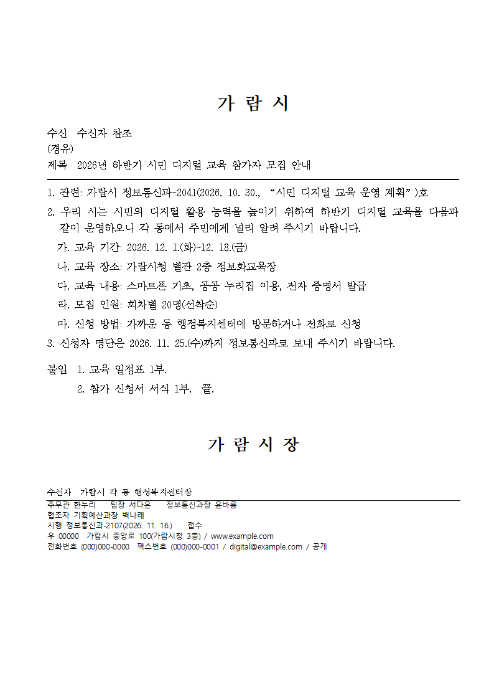
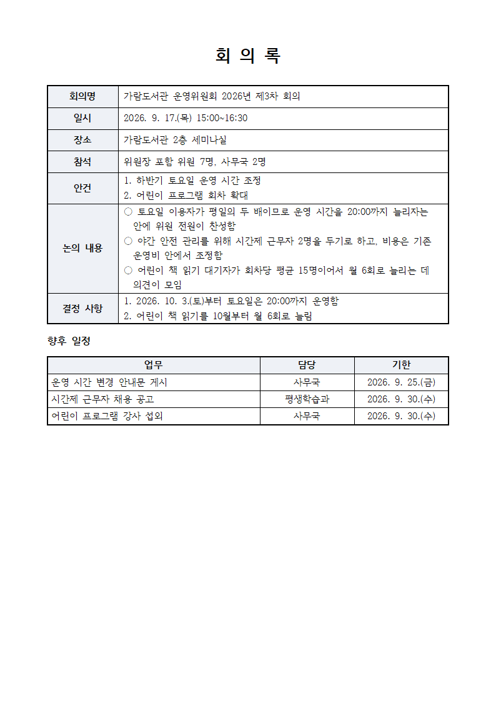
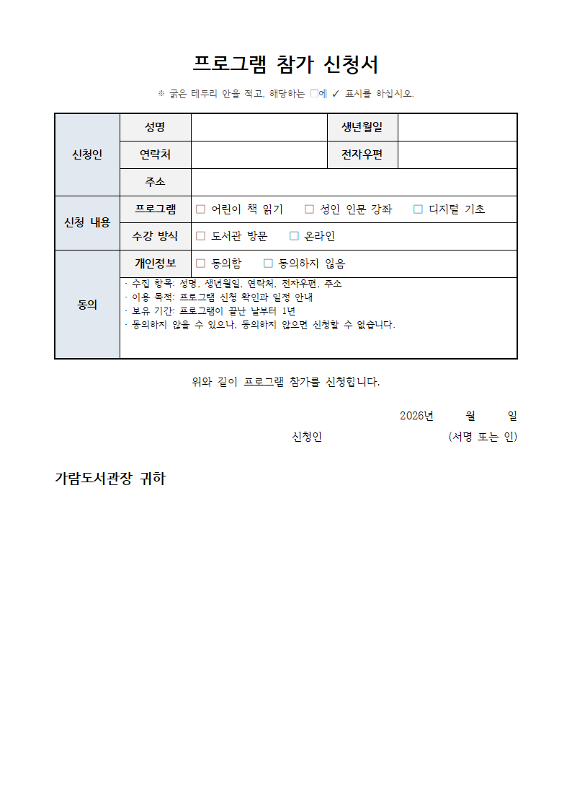

# hwpx-docs

한컴오피스 한글에서 여는 HWPX 문서를 만들고 읽고 검사하는 Claude Code 플러그인입니다(버전 0.3.0). HWPX는 공개 국가표준 OWPML(KS X 6101) 형식이며 문서를 만들고 읽는 데는 한글 프로그램이 필요 없고 Python 표준 라이브러리만 씁니다.

> 한글, 한컴오피스는 (주)한글과컴퓨터의 상표 또는 등록 상표입니다. 이 프로젝트는 (주)한글과컴퓨터와 관계가 없습니다.

## 할 수 있는 일

- JSON 스펙 하나로 문서를 만듭니다. 글자·문단 모양, 탭, 사용자 스타일, 셀 병합과 셀별 선·채움이 있는 표, 도형, 글상자, 그림, 수식, 한글 차트 개체, 쪽 설정, 머리말·꼬리말, 쪽 번호, 각주·미주, 세로쓰기, 상호 참조, 차례, 누름틀, 양식 개체, 변경 추적을 씁니다.
- 기존 HWPX를 스펙(JSON)으로 읽고 고친 뒤 다시 만듭니다.
- 받은 양식은 글자만 바꿔 채웁니다. 칸 이름(성명, 연락처 등)이나 칸 번호로 값을 넣고 체크 상자를 표시하고 낱말을 바꿉니다. 바꾼 뒤에는 구조가 같은지, 줄이 늘어 쪽이 밀리는지, 옛 문구나 ○○ 같은 자리표시가 남았는지 검사합니다.
- HWPX를 텍스트나 Markdown으로 꺼냅니다. 표는 Markdown 표로, 각주는 `[^n]`으로 바꿉니다.
- Markdown을 개조식 보고서로 바꿉니다(프리셋). HTML은 CSS를 브라우저처럼 계산해 같은 모양의 HWPX로 바꿉니다.
- 이미지로 받은 양식을 다시 만드는 절차를 담았습니다. 선과 격자를 mm 단위로 재고 확인 목록을 쓰고 렌더링한 쪽을 겹쳐 비교합니다.
- 한글 없이 쪽 그림을 그립니다(자체 렌더러). 표, 도형, 그림, 차트, 수식, 각주, 세로쓰기, 다단, 어울림 배치, 한글의 쪽 나눔 규칙을 따릅니다.
- 쪽 모양새를 점검하고 고칩니다(`hd pagefit`). 기본은 제목이 쪽 끝에 홀로 남거나 한 줄만 넘어가는 것 같은 최소한만 고칩니다. "읽기 좋게"라고 요청하면 `readable` 프로필로 읽다가 앞쪽을 다시 넘겨야 하는 곳을 없애고 쪽은 꽉 차게 맞춥니다.
- 문서 암호와 배포용 문서는 한글로 넣습니다. 주민등록번호·전화번호·이메일·카드 번호 가리기는 한글 없이 합니다(`hd secure`).
- HWP와 HWPX를 서로 바꾸고 PDF로 저장합니다(`hd convert`, 한글 필요).
- 공문은 시작 스펙과 공문 문장 규칙(gongmun-style 스킬)으로 씁니다.
- 가독성을 점검합니다(RD01~RD13). 단어 중간 줄바꿈, 양쪽 정렬로 벌어진 빈칸, 선에 붙은 셀 글자 같은 문제를 찾습니다.

양식마다 따로 짠 코드는 없습니다. 모든 문서는 같은 기본 요소(쪽, 문단, 런, 표, 도형, 그림)로 만들고 기본 요소마다 쓰는 XML은 한글 2024가 저장한 파일에서 확인했습니다.

## 예제

| 공문 안내문 | 개조식 보고서 (Markdown) | 회의록 |
|---|---|---|
|  |  |  |
| [notice.json](examples/gongmun-notice/notice.json) | [report.md](examples/report-markdown/report.md) | [minutes.json](examples/meeting-minutes/minutes.json) |

| 신청서 (체크 상자) | 차트가 있는 보고 | 표 중심 목록 |
|---|---|---|
|  |  |  |
| [form.json](examples/application-form/form.json) | [report.json](examples/chart-report/report.json) | [list.json](examples/facility-checklist/list.json) |

예제의 기관, 사람, 연락처는 모두 가상입니다. 그림은 한글 2024가 렌더링한 1쪽이며 폴더마다 원본, `.hwpx`, 1쪽 PNG가 있습니다.

## 설치

Claude Code에서 다음을 입력합니다.

```
/plugin marketplace add BlackBuddle/hwpx-docs
/plugin install hwpx-docs@blackbuddle
```

터미널에서는 `claude plugin marketplace add BlackBuddle/hwpx-docs`, `claude plugin install hwpx-docs@blackbuddle`입니다. 설치하면 스킬 11개가 생깁니다.

| 스킬 | 하는 일 |
|---|---|
| hwpx-core | 스펙으로 만들기, 읽기, 만들고 확인하는 순서, 다른 스킬 안내 |
| hwpx-text | 글자·문단, 링크·각주·필드·수식, Markdown·HTML 변환, 프리셋, 가독성 점검 |
| hwpx-table | 표: 열 너비, 행 높이, 병합, 셀별 선·채움, 머리 행 반복, 캡션, 계산식 |
| hwpx-objects | 도형, 글상자, 그림, 차트 |
| hwpx-page | 용지, 여백, 가로 방향, 다단, 머리말·꼬리말, 쪽 번호 |
| hwpx-from-image | 이미지 양식을 그대로 다시 만드는 절차 |
| hwpx-edit | 받은 양식 채우기, 문구 바꾸기와 검사, 텍스트·Markdown 추출 |
| hwpx-gongmun | 공문(기안문·시행문), 개조식 보고서 |
| hwpx-security | 한글의 파일 접근 허용 창, 공식 보안 모듈, 문서 암호, 배포용 문서, 개인 정보 가리기 |
| hwpx-readability | "읽기 좋게", 쪽 넘김 줄이기, 표 안 끊기게, 쪽 꽉 차게 (요청할 때만) |
| gongmun-style | 공문 문장 규칙(어투, 단어, 항목 기호, 날짜·금액 표기)과 검사기 |

## 요구 사항

문서를 만들고 읽는 일에는 한글이 필요 없습니다. 한글이 그린 쪽으로 확인하거나, 변환하거나, 암호를 넣을 때만 한글 2024를 씁니다.

| 작업 | 한글 | 필요한 것 |
|---|---|---|
| 만들기·읽기·채우기·추출 (`build`, `read`, `md`, `html`, `slots`, `edit`, `guard`, `text`, `form`) | 필요 없음 | Python 3.10 이상(3.14에서 시험), 운영체제 무관 |
| 점검과 고치기 (`readability`, `check`, `pagefit`, `gongmun-check`), 개인 정보 가리기 (`secure --mask-private`) | 필요 없음 | Python 3.10 이상 |
| 한글 없이 쪽 그림 (`preview`, `render hwpx f --backend preview`) | 필요 없음 | 쪽 SVG·HTML은 어디서나 나옵니다. PNG는 Windows의 Microsoft Edge로 만듭니다. 한글과 같은 줄 나눔을 보려면 한글 글꼴(함초롬바탕 등)이 설치돼 있어야 합니다 |
| 실제 글꼴 폭으로 줄 수 계산 | 필요 없음 | Windows(GDI). 다른 운영체제에서는 추정 폭을 씁니다 |
| 한글로 쪽 그림 그리기, 열리는지 확인, 왕복 시험 (`render`, `roundtrip`) | 한글 2024 | Windows, pywin32 |
| HWP↔HWPX 변환, PDF 저장 (`convert`) | 한글 2024 | Windows, pywin32 |
| 문서 암호, 배포용 문서 (`secure --password-env`, `--distribute`) | 한글 2024 | Windows, pywin32 |
| 한글의 접근 허용 창 없애기 | 한글 2024 | 선택. 한컴 공식 보안 모듈을 사용자가 직접 등록합니다(아래 절) |
| HTML 인쇄 모양과 비교 | 필요 없음 | Windows, Microsoft Edge |

## 빠른 시작

Claude에게 말로 시키면 스킬이 알맞은 명령을 고릅니다. 예: "이 Markdown을 한글 문서로 만들어 줘", "이 신청서 이미지를 그대로 hwpx로 만들어 줘", "가람시 공문으로 교육 안내문을 써 줘", "받은 신청서에 내 정보를 채워 줘", "이 보고서 읽기 좋게 쪽을 맞춰 줘".

명령을 직접 쓸 때는 플러그인 폴더의 `lib/hd.py`를 실행합니다.

```
python lib/hd.py build examples/meeting-minutes/minutes.json minutes.hwpx
python lib/hd.py md examples/report-markdown/report.md report.hwpx
python lib/hd.py html page.html page.hwpx
python lib/hd.py read some.hwpx some.json
python lib/hd.py readability minutes.hwpx
python lib/hd.py slots form.hwpx
python lib/hd.py edit form.hwpx filled.hwpx --values values.json
python lib/hd.py guard form.hwpx filled.hwpx --forbid 옛기관명
python lib/hd.py text some.hwpx --md
python lib/hd.py pagefit check report.hwpx --profile readable
python lib/hd.py pagefit fix report.hwpx report-fit.hwpx --profile readable
python lib/hd.py secure report.hwpx report-masked.hwpx --mask-private
python lib/hd.py preview minutes.hwpx pages/
python lib/hd.py render hwpx minutes.hwpx pages/
python lib/hd.py selftest
```

`python lib/hd.py help`는 명령 전체를 보여 줍니다. `values.json`에는 칸 이름이나 `slots`가 보여 준 칸 번호를 씁니다(예: `{"성명": "가람", "t1.r3c2": "000-0000-0000"}`). 없는 칸 이름이 있으면 `UNMATCHED`를 알리고 파일을 쓰지 않습니다.

스펙 형식은 [docs/spec.md](docs/spec.md)에 있습니다. 같은 모양을 여러 번 쓸 때는 `styles`에 이름을 붙이고 문단·셀·런에서 `"class": "이름"`으로 가져다 쓰고 한글의 스타일 목록에 들어가는 스타일은 `named_styles`로 만듭니다. 0.3.0에서 늘어난 스펙 키(바탕쪽 `master_pages`, 세로쓰기 `text_direction`, 첫 글자 장식 `dropcap` 등)는 spec.md의 "More keys of the feature packages" 절에 키마다 값과 예시 한 줄로 정리했습니다.

## 프리셋과 --fallback

Markdown 변환은 프리셋(JSON 데이터)에서 글꼴, 크기, 간격, 상자 모양을 가져옵니다. 기본 프리셋은 `report-gongmun`(제목 상자, 장 막대, □ ○ - · 항목, 격자 표)입니다.

프리셋에 스타일이 없는 요소(본문 인용문, 그림, 4단계 목록, 각주 등)를 만나면 `UNMAPPED`로 줄 번호와 함께 알리고 멈춥니다. `--fallback`을 붙이면 가까운 프리셋 스타일, 코어 기능, 일반 문단 순서로 대신하고 바꾼 내역을 `FALLBACK` 줄로 남깁니다. 프리셋을 늘리거나 HWPX 샘플에서 새 프리셋을 만드는 방법은 [hwpx-text 스킬의 presets.md](skills/hwpx-text/references/presets.md)에 있습니다.

## 쪽 모양새 맞추기 (pagefit)

`hd pagefit check`는 쪽마다 얼마나 찼는지, 무엇 때문에 쪽이 넘어가는지 보여 주고 `hd pagefit fix`는 스펙을 고쳐 새 파일로 씁니다. 글자 크기, 내용, 순서는 바꾸지 않습니다. 바꾸는 것은 "다음 문단과 함께" 같은 문단 설정, 쪽 나눔, 문단·표 간격뿐입니다.

무엇을 얼마나 고칠지는 개인의 읽기 스타일이라 프로필로 고릅니다.

| 프로필 | 하는 일 |
|---|---|
| `minimal` (기본) | 제목을 다음 문단과 함께 두고 쪽 끝·쪽 처음에 한 줄만 남지 않게 합니다. 거의 빈 쪽 뒤의 강제 쪽 나눔을 풀고 짧은 마지막 쪽을 끌어올리고 남는 공간은 문단 간격으로 채웁니다 |
| `readable` | 위에 더해 "읽기 단위"가 쪽을 넘어 끊기지 않게 합니다. 제목과 첫 내용, 항목과 하위 항목, 표와 캡션·소개 문장·주석, 그림과 캡션, 요약 상자, 붙임 목록, 마지막 문단과 "끝."·결문이 한 단위입니다. 쪽보다 긴 표는 행 사이에서만 나누고 머리 행을 반복하며 앞뒤 조각을 3행 이상으로 맞춥니다. 쪽의 1/3 이상인 표를 통째로 넘기면 앞 쪽이 40 mm 넘게 빌 때는 그 표만 행 사이에서 나눕니다. 통째로 두는 표는 문단과 같은 쪽에 묶어(`hold`) 뒤의 제목과 글이 표 앞으로 올라오지 않게 하고 머리 행이 없는 긴 표는 머리 행처럼 보이는 첫 행을 반복합니다. 각주가 다음 쪽으로 이어지면 그 문단을 다음 쪽에서 시작하고 표를 가리키는 문장이 다른 쪽에 있으면 알립니다 |
| 직접 만든 파일 | `--profile 내것.json`. `"extends": "readable"`로 시작해 바꿀 값만 씁니다. 형식은 [pagefit/rules.md](lib/hwpx_docs/pagefit/rules.md)의 PF22에 있고 `hd pagefit profiles readable`이 전체 값을 보여 줍니다 |

쪽 배치는 자체 렌더러의 줄 높이와 한글에서 잰 쪽 나눔 규칙으로 계산합니다. 실제 계획 문서 7개(각주 11개씩)에 `readable`을 적용해 한글로 열어 보니 쪽 수가 모두 계산과 같았고 제목만 쪽 끝에 남은 곳이 8곳에서 0곳으로, 100 mm 넘게 빈 쪽이 3쪽에서 1쪽으로 줄었습니다. 표가 뒤로 밀려 읽는 순서가 바뀐 곳은 한 문서에서 11곳에서 0곳이 됐습니다. 한글이 설치돼 있으면 고친 파일을 한글로 한 번 열어 확인하는 것이 좋습니다.

## 대응 범위

한글 기능을 C1~C14로 나눠 항목마다 한글이 만든 시료, 규칙, 빌더·리더 지원, 한글 왕복 렌더링 결과를 적었습니다. "지원"은 빌더가 쓰고 한글로 다시 열어 그렸을 때 원본과 차이가 없거나 실제 실행으로 확인한 항목입니다. 자세한 표는 [docs/coverage.md](docs/coverage.md)와 패키지마다 있는 `coverage.md`에 있습니다.

| 영역 | 지원 | 한글 동작상 불가 | 남은 일 | 남은 일과 한계 (예) |
|---|---|---|---|---|
| C1 글자 모양 | 20 | 0 | 0 | |
| C2 문단 모양 | 21 | 0 | 0 | |
| C3 스타일 | 3 | 0 | 1 | 개요 스타일을 적용할 때 스타일 참조(`styleIDRef`) 쓰기 |
| C4 쪽 | 17 | 0 | 0 | 바탕쪽 "앞 쪽과 같게"는 한글 자동화로 설정되지 않음 |
| C5 표 | 20 | 0 | 0 | 계산식 칸은 값을 계산하지 않음, 3색 그러데이션은 한글이 검게 그림 |
| C6 개체·차트 | 13 | 0 | 1 | 호(arc)를 만드는 스펙 키 |
| C7 필드·참조 | 10 | 0 | 2 | 한글 고유 차례 구조, 양식 개체 일부(여러 항목 목록 등)는 손으로 만든 시료가 필요 |
| C8 입력 | 6 | 0 | 2 | 입력 도우미의 파일 이름·상용구, 한자 병기 아이콘 형식 3가지 |
| C9 서식 | 7 | 0 | 0 | |
| C10 쪽 (추가) | 6 | 0 | 2 | 여러 쪽에 걸친 줄 번호 다시 시작, 각주·그림 번호 다시 시작 |
| C11 보안 | 4 | 2 | 0 | 선택 글자 보호(한글 암호화가 필요), 인증서·DRM 문서 보안 설정 |
| C12 변환 | 4 | 0 | 0 | 보호되거나 손상된 파일은 변환이 안 될 수 있음 |
| C13 자체 렌더러 | 11 | 0 | 1 | 글자 효과(외곽선·그림자·양각·음각), 강조점, 무늬 채움 |
| C14 쪽 모양새 | 14 | 0 | 0 | 표 아래 주석이 몇 mm 모자라 따로 떨어지는 경우의 빈 공간은 알리기만 함 |
| 합계 | 156 | 2 | 9 | |

C11 보안은 0.2.0의 5개에 "보호된 파일 읽기"가 더해져 6개 항목이 됐고 0.2.0에서 모두 "아직"이던 항목은 이제 4개 지원, 2개 한글 동작상 불가입니다. 문서 암호, 배포용 문서, 개인 정보 가리기, 보호된 파일 알림은 지원하고 선택 글자 보호와 DRM 문서 보안 설정은 한글 동작상 자동화할 수 없습니다. C13은 [preview/coverage.md](lib/hwpx_docs/preview/coverage.md)의 그리기 항목이며 필요 환경을 적은 C13.06은 세지 않았습니다.

## 한글의 "파일 접근 허용" 창과 공식 보안 모듈

스크립트가 한글로 기존 파일을 열 때(렌더링, 확인, 왕복 시험, 변환, 암호 넣기) 한글 2024가 "한글을 이용하여 위 파일에 접근하려는 시도"라는 창을 띄웁니다. HWPX를 만들거나 읽을 때(`build`, `read`, `md`, `html`, `pagefit`, `preview`)는 한글을 쓰지 않으므로 이 창이 뜨지 않습니다.

- 창이 뜨면 **모두 허용**을 누르면 됩니다. 스크립트는 한 묶음의 파일을 한글 하나로 열기 때문에 묶음마다 한 번만 누르면 됩니다.
- 스크립트는 이 창에 대신 답하지 않습니다. 300초 안에 답이 없으면 창을 닫고(거부) 그 묶음을 멈춥니다.

### 공식 보안 모듈로 창 없애기 (선택)

한컴은 자동화용 보안 승인 모듈을 공식으로 제공합니다. 아래는 사용자가 직접 하는 절차입니다. 이 플러그인은 DLL을 포함하거나 내려받거나 등록하지 않고 Claude도 이 설정을 대신하지 않습니다.

1. 한컴 개발자 센터의 [한글 오토메이션 페이지](https://developer.hancom.com/hwpautomation) "2. 보안 승인 모듈"에서 `보안모듈(Automation).zip`을 받습니다. 다른 곳에 올라온 사본은 쓰지 않습니다.
2. 압축을 풀어 `FilePathCheckerModuleExample.dll`을 원하는 폴더(예: `C:\HwpAutomation`)에 둡니다. 한컴 포럼 답변에 따르면 DLL은 한글(Hwp.exe)과 같은 비트로 빌드된 것이어야 합니다.
3. 레지스트리 편집기에서 `HKEY_CURRENT_USER\Software\HNC\HwpAutomation\Modules` 키에 문자열 값(REG_SZ)을 만듭니다. 값 이름은 원하는 이름(예: `FilePathCheckerModuleExample`)으로 하고 값 데이터에는 DLL의 전체 경로를 넣습니다. 형식은 압축 파일 안의 `레지스트리.JPG`와 [한컴 포럼 답변](https://forum.developer.hancom.com/t/topic/3206)에 있습니다.
4. 환경 변수 `HWPX_DOCS_SECURITY_MODULE`에 3번의 값 이름(예: `FilePathCheckerModuleExample`; 예전 변수 이름 `HWPX_DOCS_MODULE`도 됨)을 넣으면 스크립트가 한글을 띄운 직후, 파일을 열기 전에 `RegisterModule("FilePathCheckDLL", 값 이름)`을 부르고 `security module: on` 한 줄을 남깁니다. 변수가 없거나 레지스트리에 그 값이 없으면 부르지 않고 `security module: off`를 남깁니다(기본값은 꺼짐). 스크립트는 레지스트리를 읽기만 하고 쓰지 않습니다.

스크립트가 띄운 한글은 화면에 나오지 않게 숨깁니다. 한글이 작업 중에 창이나 알림을 띄우면 0.2초 안에 활성화 없이 다시 숨기고 8초가 지나도 남은 알림은 닫습니다. 접근 허용 창만은 사용자가 답할 수 있게 그대로 둡니다.

주의: 모듈을 등록하면 어떤 자동화 스크립트든 묻지 않고 파일을 열고 저장할 수 있습니다. 믿을 수 있는 스크립트만 실행하십시오. 한컴 개발자 센터는 상업적으로 쓸 때 별도 라이선스가 필요하다고 안내합니다.

### 문서 암호와 배포용 문서

`hd secure`는 암호화 방식을 분석하거나 직접 구현하지 않고 한글 자체 기능(`FileSetSecurity`)으로 암호와 배포용 문서를 넣습니다. 암호는 명령줄 인수로 받지 않고 `--password-env 변수이름`으로 환경 변수에서만 읽으며 화면이나 기록에 남기지 않습니다. 결과는 원본을 바꾸지 않고 새 파일로 씁니다. 암호가 걸린 HWPX는 `read`와 미리보기가 내용을 읽지 않고 `PROTECTED`로 알립니다.

## 한계

- 한글 바이너리 형식(.hwp)은 직접 읽거나 쓰지 않습니다. HWPX만 만들고 읽으며 .hwp는 한글로 HWPX로 바꾼 뒤(`convert`) 씁니다.
- 한글 차트 개체는 막대·가로 막대·꺾은선·원·혼합·영역형·분산형과 보조 축을 만듭니다. 한글 자동화는 기본 차트만 만들 수 있어 영역형·분산형·보조 축은 빌더가 쓴 파일을 한글이 다시 저장한 시료로 확인했습니다. 차트 개체를 지원하지 않는 옛 한글에서 열리는지는 확인하지 않았습니다.
- `edit`는 글자만 바꿉니다. 행이나 칸을 늘리거나 표를 새로 넣지 않습니다. 글이 길어져 줄이 늘면 `guard`가 알립니다.
- 개인 정보 가리기(`--mask-private`)는 암호화가 아니라 글자를 바꾸는 것이어서 가린 글자는 새 파일에서 사라집니다. 정해진 형식(주민등록번호, 전화번호, 이메일, 카드 번호)만 찾고 파일 안의 미리보기 글과 그림도 함께 지웁니다. 번호 한가운데서 글자 모양이 바뀌어 두 조각으로 나뉘면 찾지 못합니다.
- 스펙의 그림·OLE 경로(`src`)는 어느 폴더의 파일이든 문서에 넣습니다. 남이 준 스펙으로 만들 때는 `src`가 가리키는 파일을 먼저 확인하십시오.
- HTML 변환은 인쇄용 CSS의 주요 속성만 계산합니다. 쓰지 않은 속성은 `UNSUPPORTED`로 알립니다. 브라우저는 keep-all에서도 한글 낱말 뒤 여는 괄호 앞에서 줄을 바꾸지만 한글은 빈칸에서만 줄을 바꾸므로 한 줄이 다르게 나뉠 수 있습니다.
- 실제 글꼴 폭 계산은 Windows에서만 정확합니다.
- 자체 렌더러는 한글이 그린 쪽과 같은 모양을 목표로 하지만 같은 이미지는 아닙니다. 한글 쪽과 잉크 차이는 예제 6개 평균 11.9 %, 시험 파일 23쪽 평균 13.9 %, 차트 시험 파일 평균 18.4 %입니다(글자 가장자리 차이 때문에 0이 될 수 없습니다). 글자 효과(외곽선·그림자·양각·음각), 강조점, 무늬 채움은 그리지 않습니다. 그리지 못하는 개체는 빨간 점선 상자에 종류 이름을 써서 표시하고 `PREVIEW NOT DRAWN` 경고 줄을 냅니다. 충실도 표는 [preview/coverage.md](lib/hwpx_docs/preview/coverage.md)에 있습니다.
- pagefit의 쪽 계산은 한글에서 잰 규칙을 따르지만 한글과 몇 mm 다를 수 있습니다. 다단·각주·떠 있는 개체가 있는 구역은 자체 렌더러의 쪽 배치를 읽습니다. 세로쓰기 구역은 점검하지 않습니다.

## 시험

`python lib/hd.py selftest`는 패키지마다(core, text, table, objects, page, edit, extract, chart, convert, fields, gongmun, objects2, pagefit, pagex, preview, render, secure, textstyle, check) 자체 시험을 돌린 뒤 한글 2024로 만든 시험 파일 271개(`tests/fixtures`)를 읽고 다시 만들어 두 스펙이 같은지 확인합니다. 한글 프로그램은 필요 없습니다. 시험이 만든 임시 폴더는 끝날 때 지워지고 지워졌는지도 시험합니다.

`python lib/hd.py textstyle scan --repo`는 저장소의 모든 파일(파일 이름, 본문, HWPX 압축 안의 모든 항목, PNG 메타데이터)에서 계정 이름, 사용자 폴더 경로, 이메일 주소를 찾습니다. 예외는 [privacy.py](lib/hwpx_docs/textstyle/privacy.py)의 `ALLOWED`에 이유와 함께 적은 것과 `example.com` 같은 가상 주소뿐입니다.

## 0.3.0에서 바뀐 점

- 글자·스타일: 탭(왼쪽·오른쪽·가운데·소수점, 채움선), 줄 나눔 단위, 한글 스타일 목록에 들어가는 사용자 스타일과 다음 스타일 연결, 문단 첫 글자 장식, 덧말, 그림 글머리표를 씁니다. 한자 병기와 스타일마당은 한글이 만든 모양을 기록했습니다.
- 쪽: 홀수·짝수 쪽 머리말·꼬리말, 바탕쪽, 각주·미주 모양, 현재 쪽만 감추기, 세로쓰기, 줄 번호, 구역 안에서 단 수 바꾸기, 원고지, 라벨을 씁니다.
- 표: 선 종류 18가지, 그러데이션·그림 채우기, 떠 있는 표의 위치, 표 캡션, 계산식 칸, 셀 보호를 씁니다.
- 개체·차트: 그림 밝기·효과·자르기, 묶기, 글맵시, 어울림 배치와 기준 위치, 개체 캡션, 연결선, 펜으로 그린 선, OLE 개체, 교정 부호, 영역형·분산형 차트와 보조 축을 씁니다.
- 필드·참조: 상호 참조, 차례, 색인, 누름틀, 양식 개체(체크 상자, 라디오 단추, 목록 등)와 채우기(`hd form`), 변경 추적을 씁니다.
- 보안 후처리(`hd secure`): 한글로 문서 암호와 배포용 문서(인쇄·복사 막기)를 넣습니다. 한글 없이 개인 정보를 가리고 암호가 걸린 파일은 읽지 않고 알립니다.
- 자체 렌더러: 수식, 세로쓰기, 각주(쪽마다 번호, 다단), 어울림 배치, 탭과 채움선, 구역 안 단 바꾸기, 한글 차트 개체를 그립니다. 쪽 나눔은 한글에서 잰 규칙(다음 문단과 함께, 문단 보호, 외톨이 줄 보호, 쪽 나눔 전, P17)을 따르고 쪽 끝에 걸린 표 행은 한글처럼 셀 안에서 줄 단위로 나눕니다(P18). 그리지 못하는 개체는 점선 상자로 표시합니다.
- 쪽 모양새(`hd pagefit`)와 프로필 `minimal`·`readable`·직접 만든 파일, "읽기 좋게" 같은 요청에만 쓰는 스킬 hwpx-readability를 넣었습니다. 쪽 나눔은 제목·소개 문장 묶음의 맨 앞에 겁니다(PF23). 큰 표만 행 사이에서 나누고(PF24) 통째로 두는 표는 `hold`로 읽는 순서를 지킵니다(PF26). 긴 표는 머리 행을 반복하고(PF27) 표 안 각주가 이어지면 그 행 위에서 나눕니다(PF28).
- 공문 문장 규칙(gongmun-style)은 2.6을 그대로 함께 넣었습니다.
- 시험과 도구가 만든 임시 폴더는 끝날 때 지웁니다. 저장소 전체 개인정보 검사(`textstyle scan --repo`)를 넣었습니다.
- 한글로 만든 시험 파일이 238개에서 271개로 늘었습니다.

## 0.2.0에서 바뀐 점

- 받은 양식의 글자만 바꾸는 `slots`·`edit`, 바꾼 뒤 구조·줄 수·남은 문구를 보는 `guard`, HWPX를 텍스트나 Markdown으로 꺼내는 `text`를 넣었습니다.
- 한글 차트 개체를 만들고 읽습니다(`"native": true`, `chart` 명령).
- `convert`로 HWP와 HWPX를 서로 바꾸고 PDF로 저장합니다.
- 한글 없이 쪽 이미지를 그리는 자체 미리보기(`preview`)를 넣었습니다.
- 공문 서식 기본값을 공식 자료와 견준 표([docs/gongmun-defaults.md](docs/gongmun-defaults.md))와 기안문 검사 `gongmun-check`를 넣었습니다.
- 빌더가 쓰는 XML을 한컴이 공개한 OWPML 모델과 대조했습니다([docs/owpml-crosscheck.md](docs/owpml-crosscheck.md)).
- gongmun-style 2.6, 기능별 패키지 구조.

## 라이선스와 출처

- 라이선스: GNU Affero General Public License 3판 또는 (선택에 따라) 그 이후 판(AGPL-3.0-or-later, [LICENSE](LICENSE)), 저작권자 BlackBuddle. 고친 판을 배포하거나 네트워크 서비스로 제공하면 그 소스도 같은 라이선스로 공개해야 합니다. 이 프로그램은 보증 없이 제공합니다.
- HWPX 형식: 국가표준 KS X 6101(OWPML). XML 규칙은 한글 2024가 저장한 시험 파일에서 하나씩 확인했습니다([docs/rules.md](docs/rules.md)). 한컴이 공개한 OWPML 모델과 대조한 결과는 [docs/owpml-crosscheck.md](docs/owpml-crosscheck.md)에 있습니다.
- 공문 규칙: 자유롭게 이용할 수 있는 공공 자료만 근거로 씁니다. 행정안전부 「2025 행정업무운영 편람」, 「행정업무의 운영 및 혁신에 관한 규정」과 같은 규정 시행규칙, 한글 맞춤법, 관보·국가기록원·문화체육관광부·법제처의 순화어 자료 등입니다. 출처마다 이용 조건을 [출처 목록](skills/gongmun-style/references/sources.md)에 적었습니다.
- 한컴 보안 승인 모듈은 이 저장소에 들어 있지 않습니다. 한컴 개발자 센터에서 사용자가 직접 받습니다.
- 함께 쓰면 좋은 스킬: 한국어 문장을 자연스럽게 쓰도록 돕는 `ko-writing` 스킬(이 플러그인에는 들어 있지 않습니다).

## English

hwpx-docs is a Claude Code plugin that makes, reads and checks HWPX documents (OWPML, Korean standard KS X 6101) for Hancom Office Hangul. Version 0.3.0. Generation needs only the Python 3.10+ standard library on any OS; rendering in Hangul, conversion and password protection need Windows with Hangul 2024 and pywin32.

- Install: `/plugin marketplace add BlackBuddle/hwpx-docs`, then `/plugin install hwpx-docs@blackbuddle` (11 skills).
- Version 0.3.0: tabs, user styles, drop caps, 덧말, picture bullets; odd/even headers, master pages, note shapes, vertical writing, line numbers, column changes, 원고지, labels; 18 table line types, gradient and picture fills, floating tables, captions, formula cells, cell protection; picture effects, groups, 글맵시, wrapping, connectors, OLE, proofreading marks, area and scatter charts with a secondary axis; cross-references, table of contents, index, 누름틀, form objects (`form`), track changes; password, distribution document and personal data masking (`secure`); an own page renderer that draws equations, vertical writing, footnotes, wrapping and Hangul's keep rules; page fitting with profiles (`pagefit`, skill hwpx-readability); automatic clean-up of temporary folders; a repository privacy scan (`textstyle scan --repo`).
- Command line: `python lib/hd.py help` lists every command.
- Input: a JSON spec ([docs/spec.md](docs/spec.md)), Markdown (presets with `UNMAPPED`/`--fallback`), any HTML (CSS computed like a browser), or an image of a form (measure, checklist, overlay).
- Coverage: 156 of 167 items supported, 2 not possible by Hangul's behaviour (selective text protection, certificate/DRM security), 9 open ([docs/coverage.md](docs/coverage.md)).
- Hangul's file-access prompt appears only when a script opens files in Hangul; click "모두 허용" once per batch. The plugin never answers it, and never ships, downloads or registers a DLL. Hancom's official automation security module is an optional step that the user performs (see the Korean section above).
- License: GNU AGPL-3.0-or-later (Copyright (C) 2026 BlackBuddle). If you convey a modified version or run it as a network service, its source must be available under the same license. No warranty.
- Hangul and Hancom Office are trademarks of Hancom Inc.; this project is not affiliated with Hancom Inc.
